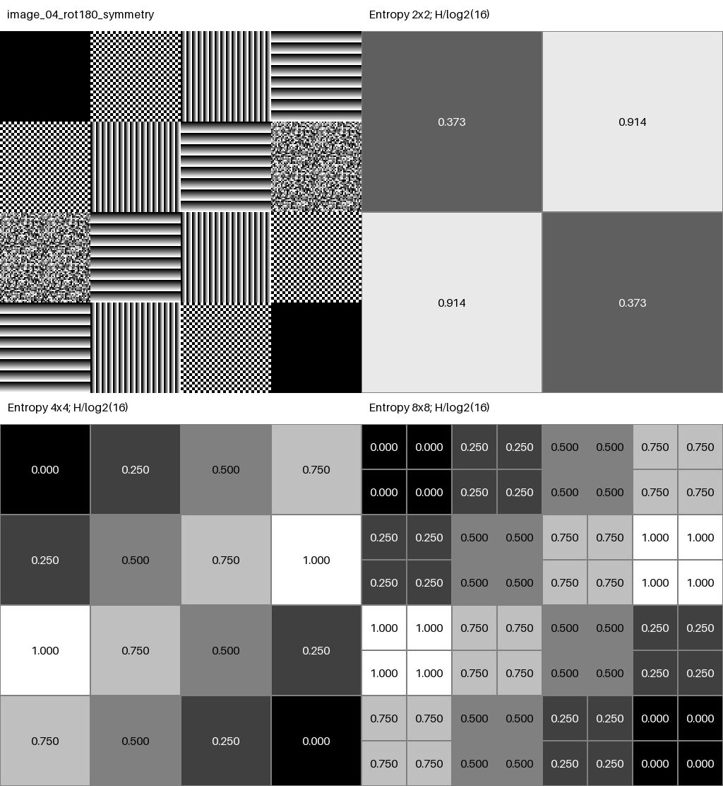
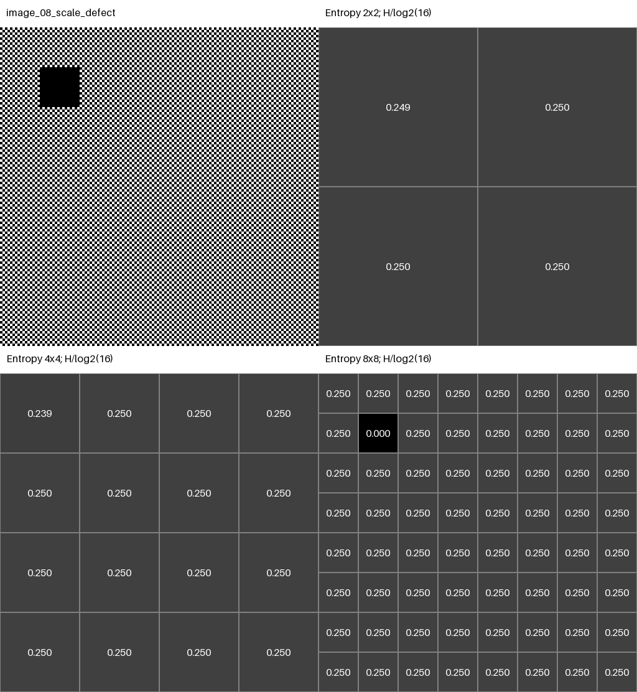

# Nine entropy-layout asymmetry features — laboratorio de comprensión

## 1. Purpose

Entender qué miden nueve residuos de **asimetría de la distribución espacial de
entropía**. No se calculan diferencias entre píxeles de la imagen. Un valor cero
significa que el mapa de entropía coincide con su transformación; un valor mayor
significa mayor discrepancia promedio. No significa mejor imagen, defecto seguro
ni mayor utilidad predictiva.

Todo vive en este laboratorio. No modifica `src/`, `experiments/`, CNNs ni otros
laboratorios. Usa listas de Python, standard library y Pillow ya instalado.
Se revisaron las instrucciones y los laboratorios 01–04. Se reutiliza `e1` de
`../03_entropy_benchmark/entropy_benchmark.py`: es una función escalar desacoplada
que no ejecuta el benchmark al importarse. Solo el conteo cuantizado y la
partición espacial son locales; no se reproduce el benchmark de entropía.
Conservar las carpetas 03 y 05 como hermanas.

Ruta recomendada de lectura: cálculo manual → matrices → `symmetry_features.py`
→ imágenes → escala → limitaciones. Los números de este README corresponden a
la ejecución local del **1 de octubre de 2026**, B=16, seed=20261001.

## 2. The 85 + 9 feature idea

| Nivel | Valores de entropía | Residuos de asimetría |
|---|---:|---:|
| 1×1 | 1 | 0 |
| 2×2 | 4 | 3 |
| 4×4 | 16 | 3 |
| 8×8 | 64 | 3 |
| Total | **85** | **9** |

El descriptor combinado tiene 94 posiciones: primero las 85 entropías, en orden
de nivel 1,2,4,8 y por filas dentro de cada nivel; después nueve valores A en orden
LR, TB, R180 para 2,4,8. No se añaden scores `S=1-A`: serían una recodificación
redundante. Los nueve A son funciones deterministas de los 85 valores de
entropía: tampoco añaden información nueva en sentido informacional. Hacen
explícitas ciertas relaciones espaciales que un modelo podría aprovechar.

## 3. Entropy pyramid

```text
IMAGE (grayscale)
  |
  v
spatial partition
  |
  v
local histogram -> counts -> probabilities -> p * log2(p) -> entropy
  |
  v
entropy grids
  |
  +---- 1×1 -> entropy only
  |
  +---- 2×2 -> entropy + LR/TB/R180
  |
  +---- 4×4 -> entropy + LR/TB/R180
  |
  +---- 8×8 -> entropy + LR/TB/R180
  |
  v
85 entropy values + 9 asymmetry values = 94-dimensional descriptor
```

Para cada región de N píxeles en modo `L` (intensidades 0…255):

```text
bin(pixel) = pixel * B // 256
counts[b] = número de píxeles en bin b
p[b] = counts[b] / N
H = -sum(p[b] * log2(p[b]))    (omitir p=0)
E[i][j] = H / log2(B)
```

B es configurable entre 2 y 256, por defecto 16. Son intervalos fijos de
intensidad, no cuantiles ni bins adaptados a cada patch. Para B que no divide
256, los intervalos pueden tener diferente cantidad de intensidades enteras.
`0 <= H <= log2(B)`, luego `0 <= E <= 1`. Si N<B no se pueden ocupar B bins:
la cota más ajustada incluye `log2(min(B,N))`; no renormalizamos por N.

Ejemplo de textura binaria equilibrada con B=16: counts de negro y blanco son
512 y 512 en una celda 32×32, p=.5,.5; cada `p*log2(p)=-.5`, H=1 bit y E=.25.
Una textura de 16 niveles equiprobables tiene H=4 y E=1; intensidad constante
tiene H=0. Ruido no equivale a información semántica útil.

Cada nivel recorta directamente la imagen. **No** promedia entropías del nivel
inferior: la entropía de una mezcla de histogramas no es en general el promedio
de sus entropías. `results.json` conserva counts, probabilidades, términos y H
de la primera celda 8×8 de cada imagen para inspeccionar el cálculo.

La implementación exige ancho y alto múltiplos positivos de 8, sin recortar,
redimensionar ni rellenar silenciosamente. Acepta imágenes rectangulares con
celdas rectangulares de igual área dentro de cada nivel. Los ejemplos son 256×256.

## 4. Why 1×1 has no symmetry extras

La matriz `[a]` reflejada o rotada sigue siendo `[a]`. Siempre se cumple
`A_LR=A_TB=A_R180=0`, sea cual sea a. El valor de entropía global 1×1 sí ocupa
una de las 85 posiciones, pero tres ceros extra no aportarían variación.
Por eso g pertenece a {2,4,8} para asimetría: exactamente 3×3=9 features.

## 5. Left-right asymmetry

Left-right reflection intercambia **columnas**: refleja respecto al eje vertical.

```text
LR(E)[i][j] = E[i][g-1-j]
A_LR = sum_i sum_j abs(E[i][j] - E[i][g-1-j]) / g²
```

En Python se invierte el orden de los valores de cada fila, sin invertir filas.
El denominador cuenta las g² celdas; cada pareja aparece dos veces. No hay que
dividir otra vez por dos. Es la norma L1 **elemento a elemento**, no la norma
matricial inducida definida como máximo de sumas de columnas.

**Rango matemático.** Cada diferencia absoluta pertenece a [0,1]. Su media
también: `0 <= A <= 1`. Para los tamaños pares 2,4,8 cada transformación carece
de puntos fijos; se puede alcanzar A=1 asignando 0 a un miembro de cada pareja
y 1 al otro. Esto es alcanzabilidad individual, no afirma que los tres A puedan
valer 1 simultáneamente. A=0 si y solo si todas las parejas coinciden.

Las mismas cotas valen para TB y R180. No hacemos clipping. Se rechazan valores
no finitos o fuera de [0,1], matrices vacías, no cuadradas o de dimensión errónea.
Los tests usan tolerancias de punto flotante para igualdades decimales.
Las funciones genéricas aceptan también g impar: los puntos fijos aportan cero;
para LR/TB la cota superior ajustada es `(g-1)/g`, y para R180 `1-1/g²`.

## 6. Top-bottom asymmetry

Top-bottom reflection intercambia **filas**: refleja respecto al eje horizontal.

```text
TB(E)[i][j] = E[g-1-i][j]
A_TB = sum_i sum_j abs(E[i][j] - E[g-1-i][j]) / g²
```

Se invierte el orden de las filas y se conserva el orden dentro de cada una.
Retorna un residuo en [0,1]; cero significa igualdad arriba-abajo del mapa E.

## 7. 180-degree rotational asymmetry

```text
R180(E)[i][j] = E[g-1-i][g-1-j]
A_R180 = sum_i sum_j abs(E[i][j] - E[g-1-i][g-1-j]) / g²
```

Se invierten filas y columnas. R180=LR∘TB=TB∘LR, pero su residuo **no** es la
suma de los otros residuos. Las tres transformaciones son involuciones:
aplicarlas dos veces recupera E.

Hay relaciones matemáticas, no independencia absoluta:

```text
abs(A_LR - A_TB) <= A_R180 <= A_LR + A_TB
```

Resultan de la desigualdad triangular y de que las permutaciones conservan
la norma L1. Existen las otras dos desigualdades por permutación de nombres.
Si LR=0, R180=TB; si TB=0, R180=LR; si R180=0, LR=TB.
Dos simetrías exactas implican la tercera. Esto no vuelve intercambiables las
tres features: pueden anularse para transformaciones diferentes, como muestra D.

## 8. Manual worked example

La matriz E, con g=2 y g²=4, es:

```text
0.1  0.7
0.2  0.4
```

**LR: invertir columnas.**

```text
LR(E) =           abs(E-LR(E)) =
0.7  0.1          |.1-.7|  |.7-.1| = 0.6  0.6
0.4  0.2          |.2-.4|  |.4-.2| = 0.2  0.2

suma = 0.6 + 0.6 + 0.2 + 0.2 = 1.6
A_LR = 1.6 / 4 = 0.4
```

**TB: invertir filas.**

```text
TB(E) =           abs(E-TB(E)) =
0.2  0.4          |.1-.2|  |.7-.4| = 0.1  0.3
0.1  0.7          |.2-.1|  |.4-.7| = 0.1  0.3

suma = 0.1 + 0.3 + 0.1 + 0.3 = 0.8
A_TB = 0.8 / 4 = 0.2
```

**R180: invertir ambos índices.**

```text
R180(E) =         abs(E-R180(E)) =
0.4  0.2          |.1-.4|  |.7-.2| = 0.3  0.5
0.7  0.1          |.2-.7|  |.4-.1| = 0.5  0.3

suma = 0.3 + 0.5 + 0.5 + 0.3 = 1.6
A_R180 = 1.6 / 4 = 0.4
```

Comprobación independiente del código: sumando los cuatro términos escritos y
dividiendo por cuatro obtenemos (.4,.2,.4). Los tests verifican tanto las
diferencias celda a celda como esos tres resultados.

## 9. Synthetic matrix examples

Estas matrices se especifican directamente como entropías normalizadas. No se
presupone una imagen subyacente. Cada una se evalúa en su tamaño real; no se
inventan versiones 2×2/4×4/8×8 de una matriz pequeña.

**A — uniforme 2×2:** `[[.5,.5],[.5,.5]]`. Cualquier permutación conserva todos
los valores: los tres residuos son cero. Entropía uniforme .5 no significa
imagen de intensidad uniforme; son conceptos diferentes.

**B — solo LR:**

```text
0.1  0.8  0.8  0.1
0.2  0.7  0.7  0.2
0.4  0.3  0.3  0.4
0.9  0.5  0.5  0.9
```

**C — solo TB:** transpuesta de B.

```text
0.1  0.2  0.4  0.9
0.8  0.7  0.3  0.5
0.8  0.7  0.3  0.5
0.1  0.2  0.4  0.9
```

**D — R180, sin reflexiones:**

```text
0.1  0.2  0.3  0.4
0.5  0.6  0.7  0.8
0.8  0.7  0.6  0.5
0.4  0.3  0.2  0.1
```

Cada elemento coincide con el opuesto respecto al centro. El .1 superior
izquierdo se compara con .4 al reflejar LR o TB: no hay esas simetrías.
R180 puede ser cero mientras las reflexiones son positivas; no son tres copias
de una misma medida. Esto no demuestra independencia estadística ni utilidad
incremental en un modelo.

**E — asimétrica:** la matriz 2×2 del cálculo manual.

| Caso | LR | TB | R180 |
|---|---:|---:|---:|
| A | 0 | 0 | 0 |
| B | 0 | .425 | .425 |
| C | .425 | 0 | .425 |
| D | .200 | .200 | 0 |
| E | .400 | .200 | .400 |

**F — defecto progresivo:** partir de una matriz 4×4 llena de .5 y sumar delta
solo a `[0][0]`. Ningún valor supera .9. Para cada transformación hay dos
entradas de diferencia delta, luego `A=2*delta/16=delta/8`.

| Perturbation | LR | TB | R180 |
|---:|---:|---:|---:|
| 0.00 | 0 | 0 | 0 |
| +0.05 | .00625 | .00625 | .00625 |
| +0.10 | .01250 | .01250 | .01250 |
| +0.20 | .02500 | .02500 | .02500 |
| +0.40 | .05000 | .05000 | .05000 |

La respuesta es lineal en este ejemplo porque perturbamos E directamente.
Modificar píxeles y recalcular entropía introduce una transformación no lineal.
Ver [tabla generada](outputs/matrices/progressive_defect.csv) y
[matrices y medidas exactas](outputs/matrices/results.json).

## 10. Synthetic image examples

No se descargan imágenes ni datasets. Cinco texturas 64×64 forman los layouts:
constante, damero binario, franjas verticales de 4 niveles, franjas horizontales
de 8 niveles y ruido balanceado de 16 niveles. Sus entropías a B=16 son
0,.25,.5,.75,1 en las celdas de 4×4 y 8×8. Los niveles son equiespaciados en
0…255. El ruido se construye barajando cantidades iguales de cada intensidad
en un tile 32×32, repetido espacialmente: **no es ruido IID**. Esto evita que
fluctuaciones accidentales del histograma rompan las simetrías declaradas.

| Archivo PNG en `outputs/images/` | Construcción e interpretación |
|---|---|
| `image_01_full_symmetry.png` | Texturas de entropía variada, layout LR+TB+R180 |
| `image_02_lr_symmetry.png` | Mismas texturas en columnas espejo; filas superiores e inferiores diferentes |
| `image_03_tb_symmetry.png` | Layout transpuesto del 02; TB exacta, LR y R180 positivas |
| `image_04_rot180_symmetry.png` | Tipos de textura iguales en posiciones opuestas; sin reflexiones de entropía |
| `image_05_asymmetric.png` | Layout no simétrico bajo ninguna de las tres transformaciones |
| `image_06_symmetric_plus_defect.png` | 01 con ruido 32×32 añadido en (x=0,y=0) |
| `image_07_scale_baseline.png` | Damero binario equilibrado en toda la imagen |
| `image_08_scale_defect.png` | 07 con bloque negro 32×32 en (x=32,y=32) |
| `image_09_equal_entropy_different_structure.png` | 07 con franjas binarias en ese bloque: distinto patrón, mismo histograma |

El nombre «symmetry» de los archivos describe el **layout de entropía**, no
garantiza reflexión exacta de los píxeles de cada textura. Todas las propiedades
de los seis primeros casos se comprueban en las tres escalas con B=16.

Valores medidos, expresados como (LR,TB,R180):

| Imagen | 2×2 | 4×4 | 8×8 |
|---|---|---|---|
| 01 | (0,0,0) | (0,0,0) | (0,0,0) |
| 02 | (0,.541485,.541485) | (0,.5,.5) | (0,.5,.5) |
| 03 | (.541485,0,.541485) | (.5,0,.5) | (.5,0,.5) |
| 04 | (.541485,.541485,0) | (.5,.5,0) | (.5,.5,0) |
| 05 | (.526849,.294215,.526849) | (.5,.3125,.5) | (.5,.3125,.5) |
| 06 | (.029772,.029772,.029772) | (.053164,.053164,.053164) | (.03125,.03125,.03125) |



## 11. Scale: 2×2 vs 4×4 vs 8×8

El caso 08 sustituye 1024 píxeles, **1/64 de la imagen**, por negro. En el caso
07 todas las celdas tienen E=.25. En el 08 solo una celda por nivel cambia:

| Nivel | Fracción de esa celda sustituida | E de celda afectada | LR=TB=R180 medido | Máximo de `abs(E-LR(E))` |
|---|---:|---:|---:|---:|
| 2×2 | 1/16 | .249295100 | .000352450 | .000704900 |
| 4×4 | 1/4 | .238608501 | .001423937 | .011391499 |
| 8×8 | 1 | 0 | .007812500 | .250000000 |

Derivación independiente: si f es la fracción reemplazada, la proporción negra
pasa de .5 a `p=(1+f)/2`; la blanca es `1-p`. Por tanto
`E=h2(p)/4`, donde `h2(p)=-p log2(p)-(1-p)log2(1-p)`. El resto de celdas
sigue en .25. Cada transformación compara el defecto con otra celda:
`A=2*(.25-E)/g²`. Esta expresión reproduce los valores medidos y tiene un test.



El histograma grueso diluye el cambio; la rejilla fina localiza el bloque en
fila 1, columna 1 (índices desde cero). En las diferencias aparecen **dos**
celdas: la del defecto y su pareja transformada; no hay dos defectos físicos.
Las figuras usan una escala fija 0→negro, 1→blanco; no amplifican contrastes por
imagen. Los números impresos a tres decimales pueden ocultar diferencias muy
pequeñas; el JSON/CSV guarda la precisión completa.

Este caso apoya una interpretación de 2×2 como comparación gruesa, 4×4
intermedia y 8×8 fina. **No es una ley de sensibilidad monótona.** En el caso
06, A sube de .029772 a .053164 y baja a .031250. Influyen la mezcla de
histogramas y la división por g²: localizar mejor no implica mayor media.
Además, en varios casos 4×4 y 8×8 coinciden porque las texturas se repiten
dentro de cada celda 4×4. No se fuerza que las escalas siempre sean distintas.

## 12. Interpretation of the nine features

| Posición en 9D (desde cero) | Clave | Compara |
|---:|---|---|
| 0 | lr_2x2 | Columnas espejo de E² |
| 1 | tb_2x2 | Filas espejo de E² |
| 2 | rot180_2x2 | Posiciones opuestas de E² |
| 3 | lr_4x4 | Columnas espejo de E⁴ |
| 4 | tb_4x4 | Filas espejo de E⁴ |
| 5 | rot180_4x4 | Posiciones opuestas de E⁴ |
| 6 | lr_8x8 | Columnas espejo de E⁸ |
| 7 | tb_8x8 | Filas espejo de E⁸ |
| 8 | rot180_8x8 | Posiciones opuestas de E⁸ |

En 94D ocupan posiciones 85…93. `compute_nine_asymmetry_features(E2,E4,E8)`
devuelve un diccionario con este orden de inserción. Cada wrapper público
verifica su dimensión exacta. Un A=.2 significa diferencia absoluta media .2
en entropía normalizada; no significa «20% de píxeles defectuosos».
Los escalares pierden la ubicación y el signo de la diferencia; los mapas
de diferencias sí permiten ver las parejas responsables.

## 13. When these features work

**When these symmetry features work — and when they do not** es la pregunta
central de esta sección y la siguiente.

Funcionan como medidas de *entropy-layout symmetry*: detectan discrepancias
de entropía entre regiones emparejadas por una transformación concreta. B, C y
D separan reflexión de columnas, reflexión de filas y rotación. Los casos 06
y 08 detectan cambios de histograma y entropía en una región sin su réplica
espejo. Para g par una única celda alterada de un mapa antes perfectamente
simétrico rompe las tres simetrías si su entropía cambia. Varios cambios
coordinados pueden preservar alguna transformación.

Un objeto con silueta simétrica y textura ruidosa solo a un lado puede generar
A positivo: la geometría de la silueta no obliga a igualdad de histogramas.
Hay que precisar el lenguaje: una imagen **pixel-perfect** simétrica, con
partición alineada y conversión consistente, sí tiene histogramas espejo
iguales. No puede tener simultáneamente píxeles perfectamente simétricos y
texturas espejo diferentes. «Geometría simétrica» aquí se refiere al contorno
o disposición de objetos, no a todos los valores de intensidad.

## 14. When these features fail

1. **Estructuras diferentes con igual entropía.** En 09, un bloque cambia de
   damero a franjas. Los píxeles dejan de coincidir bajo LR, TB y R180; el
   histograma sigue siendo 50% negro, 50% blanco en cada celda. Los nueve A son
   exactamente cero. El test compara los bytes con las imágenes transformadas
   y verifica simultáneamente A=0. El histograma ignora el orden interno; además,
   histogramas diferentes también pueden tener la misma entropía.
2. **Descriptor trivial.** Una imagen constante tiene H=0 en todas partes y
   los tres A=0. No se ha descubierto estructura útil. Una textura ruidosa
   homogénea también puede producir un mapa aproximadamente uniforme y A bajo.
3. **Defecto sin contraste de entropía.** Un cambio de forma, orientación o
   intensidad que conserve H de la pareja espejo puede pasar desapercibido.
   El caso 09 es un ejemplo exacto, no solo una posibilidad verbal.
4. **Cambios simétricos.** Dos o más defectos dispuestos simétricamente pueden
   conservar los A. El cero describe una igualdad, no la ausencia de defectos.
5. **Promedio y pérdida espacial.** Una discrepancia grande en pocas celdas se
   diluye por g². El descriptor 9D no indica dónde está el defecto.

## 15. Important limitations

- **Crop:** cambiar el recorte altera el centro, las parejas y los histogramas.
  Una imagen simétrica recortada de forma desigual puede dar A positivo.
- **Alignment:** desplazar el objeto o la rejilla cambia la asignación a celdas.
  No se busca automáticamente un eje ni se registra la imagen.
- **Grid partition:** un defecto puede cruzar bordes y repartirse entre varias
  regiones; estas métricas dependen de la partición fija. Los niveles no son
  invariantes a traslación ni a rotaciones arbitrarias.
- **Image aspect ratio:** una g×g rejilla no garantiza regiones físicamente
  cuadradas. En imágenes rectangulares refleja coordenadas normalizadas del
  encuadre, no una escala física isotrópica.
- **Padding:** el relleno puede cambiar histogramas, introducir bordes o crear
  falsas simetrías. Aquí no hay padding; tamaños no divisibles se rechazan.
- **Bins y normalización:** cambiar B modifica cuantización y escala; no
  comparar magnitudes de configuraciones diferentes como si fueran idénticas.
  Los resultados detallados del README son B=16; el CLI acepta otras B sin
  prometer conservar todos los contrastes entre tipos de textura.
- **Redundancia parcial:** las tres métricas satisfacen desigualdades y casos
  de igualdad (sección 7); las nueve derivan de los 85 valores. No se afirma
  independencia ni novedad informacional.
- **Control experimental:** patrones alineados, repetidos y balanceados facilitan
  la comprensión. No representan la diversidad, ruido o desalineación real.
- **Alcance computacional:** no se midieron latencias, FLOPs ni consumo. Calcular
  solo nueve números adicionales no demuestra que el pipeline sea eficiente.

## 16. How to run

Desde PowerShell, sin activar el entorno:

```powershell
Set-Location D:\Publications\2026-10-Symmetry-Entropy
.\code\.venv\Scripts\python.exe .\code\understanding\05_symmetry_features\run_demo.py
.\code\.venv\Scripts\python.exe .\code\understanding\05_symmetry_features\run_demo.py --help
.\code\.venv\Scripts\python.exe .\code\understanding\05_symmetry_features\tests\test_symmetry_features.py
.\code\.venv\Scripts\python.exe -m pip check
```

La secuencia solicitada con activación también funciona:

```powershell
Set-Location D:\Publications\2026-10-Symmetry-Entropy\code
.\.venv\Scripts\Activate.ps1
Set-Location understanding\05_symmetry_features
python run_demo.py
python run_demo.py --bins 16
python run_demo.py --help
```

Cada ejecución sustituye los archivos de igual nombre en su directorio de
salida, sin limpiar otros archivos. Para conservar una ejecución, usar otra ruta:

```powershell
python run_demo.py --bins 32 --seed 20261001 --output outputs\bins32
```

La ruta por defecto se resuelve desde el script; `--output` relativo se resuelve
desde el directorio actual. No necesita red ni GPU. No instala dependencias.

Validación realizada: **20 tests**, todos correctos; incluyen fórmulas exactas,
transformaciones e involuciones, no mutación, dimensiones de los nueve wrappers,
valores inválidos, rango y extremos alcanzables, relaciones triangulares,
defecto progresivo, Shannon y cuantización, reproducibilidad, propiedades de
las seis imágenes en cada escala, colisión de entropía, fórmula analítica de
escala, caso no monótono, B=7/16/256, orden y tamaños 85/9/94, CLI y lectura de
los **304 PNG** de una ejecución completa en directorio temporal.
`pip check`: **No broken requirements found**. Se inspeccionaron visualmente
los paneles R180 y de escala; el ejemplo manual da (.4,.2,.4).
No se ejecutaron experimentos de clasificación ni benchmarks anteriores:
quedan fuera de este laboratorio.

## 17. Generated outputs

```text
outputs/
  matrices/
    A_uniform/...                original, LR, TB, R180 y 3 diferencias
    B_lr_only/...                lo mismo para B, C, D y E
    F_defect_0.00/...             cinco perturbaciones, incluido control cero
    results.json                 matrices y resultados completos
    progressive_defect.csv       tabla de sensibilidad
  images/                        nueve imágenes fuente 256×256, modo L
  entropy_grids/<image>/
    entropy_2x2.png               valores, negro=0 y blanco=1
    entropy_4x4.png
    entropy_8x8.png
    overview.png                 original y las tres rejillas
  differences/<image>/<g>x<g>/
    original_<g>x<g>.png
    mirror_lr_<g>x<g>.png
    mirror_tb_<g>x<g>.png
    rot180_<g>x<g>.png
    difference_lr_<g>x<g>.png
    difference_tb_<g>x<g>.png
    difference_rot180_<g>x<g>.png
  results.json                   parámetros, versiones, hashes de píxeles,
                                 E1/E2/E4/E8, 85 entropías, 9 A, 94D y traces
  scale.csv                      tres escalas y contraste máximo de celda
```

Son 10 casos de matrices (A–E y cinco F), nueve imágenes fuente y 304 PNG en
total. El 1×1 se conserva en JSON, no como panel de simetría. Las imágenes de
diferencia usan `abs(E-T(E))`, no `abs(image-T(image))`.

Recorrido visual: [panel R180](outputs/entropy_grids/image_04_rot180_symmetry/overview.png),
[panel del defecto](outputs/entropy_grids/image_08_scale_defect/overview.png),
[colisión de entropía](outputs/entropy_grids/image_09_equal_entropy_different_structure/overview.png),
[diferencia LR del defecto 8×8](outputs/differences/image_08_scale_defect/8x8/difference_lr_8x8.png).

## 18. Implications for the paper

Podemos afirmar que los nueve residuos resumen diferencias absolutas medias de
entropía normalizada entre regiones emparejadas por dos reflexiones y una
rotación, en tres particiones espaciales. El laboratorio demuestra su cálculo,
rango, casos exactos y algunas limitaciones constructivas. No demuestra mejoras
de clasificación, detección de defectos reales ni ahorro computacional.

Una evaluación posterior podría comparar, con protocolos comparables:

```text
entropy-only:   85D
asymmetry-only:  9D
combined:      94D
```

Esa ablation **no se ejecuta aquí**. Su utilidad predictiva y posible valor
como relaciones explícitas para un modelo deberán medirse; no se deducen de
estas imágenes controladas. No se integran clasificadores ni selección de
features y no se propone todavía una conclusión científica de rendimiento.
