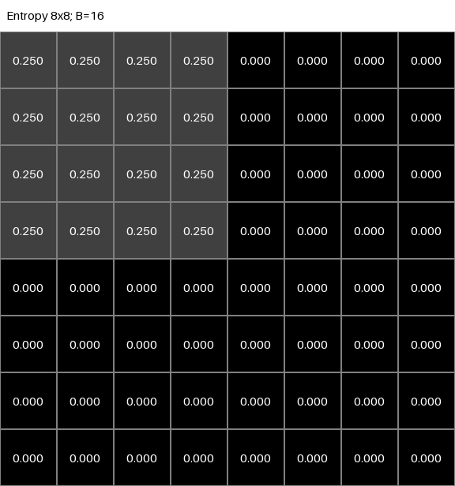

# Entropy Pyramid Descriptor — image → x94

## 1. Purpose

Implementación **canónica dentro de understanding** del descriptor manual de
94 componentes. Define una API reproducible e inspeccionable para que los
experimentos posteriores, especialmente `07_descriptor_behavior`, importen el
extractor sin copiar sus fórmulas. El alcance termina en `image -> x94`.

Se revisaron AGENTS.md, el README principal y los laboratorios 01–05. Se conserva
la convención de 05: `bins=16`, normalización por `log2(B)` y asimetrías en [0,1].
Se reutilizan directamente `e1` de 03, las nueve asimetrías y dos imágenes
sintéticas de 05. No se modifican los laboratorios anteriores ni el pipeline.

La partición nueva es necesaria porque 01 trabaja con tamaño de patch y políticas
DROP/PARTIAL/PAD, y 05 exige dimensiones divisibles por 8. El pequeño conteo
cuantizado local deja visible la fórmula y evita los imports globales de la
pirámide de 05; Shannon sigue delegado a E1, salvo su caso equiprobable exacto.
No hay LUTs, NumPy, pandas, matplotlib ni nuevas dependencias: solo stdlib y Pillow.

Archivos: `descriptor.py` (pipeline), `feature_names.py` (schema), `partition.py`
(fronteras), `entropy.py` (traza escalar), `synthetic_examples.py`, `run_demo.py`,
`__init__.py` (API) y `tests/test_descriptor.py`. Las imágenes sintéticas y el
ejemplo manual se generan en `outputs/`; no necesitan una carpeta de assets aparte.

## 2. Descriptor definition

```text
grayscale image
      |
      v
spatial pyramid
      +--> 1x1 entropy ->  1 value
      +--> 2x2 entropy ->  4 values
      +--> 4x4 entropy -> 16 values
      +--> 8x8 entropy -> 64 values
      |
      v
85 entropy features
      +--> asymmetry on 2x2: LR, TB, R180
      +--> asymmetry on 4x4: LR, TB, R180
      +--> asymmetry on 8x8: LR, TB, R180
      |
      v
9 asymmetry features
      |
      v
x94 = entropy_features + asymmetry_features
```

## 3. Why 85 entropy features

Hay una entropía por celda: `1² + 2² + 4² + 8² = 1 + 4 + 16 + 64 = 85`.
Se conserva también la entropía global, no se sustituye por los niveles finos.

## 4. Why 9 asymmetry features

Tres transformaciones en tres escalas: `3 × 3 = 9`. En 1×1 toda transformación
devuelve la misma matriz y sus residuos serían siempre cero; se excluyen.

## 5. Why total dimension is 94

Se concatenan 85 entropías y nueve residuos, sin features auxiliares: `85+9=94`.
Los nueve residuos son funciones de las entropías y no añaden información nueva
en sentido informacional; hacen explícitas relaciones entre celdas.

## 6. Spatial pyramid

Cada nivel `g ∈ (1,2,4,8)` se calcula sobre la imagen grayscale completa. Cada
celda recorta sus píxeles y construye su histograma. **No se promedian entropías
hijas**: la entropía de histogramas mezclados no es la media de sus entropías.
Ejemplo: mitad izquierda negra y derecha blanca tienen H local cero, pero la
imagen completa tiene H=1 bit (E=.25 con B=16).

## 7. Image partitioning

`partition_boxes(width, height, g)` devuelve cajas `(x0,y0,x1,y1)` por filas:

```python
x0 = col * width // g
x1 = (col + 1) * width // g
y0 = row * height // g
y1 = (row + 1) * height // g
```

Son intervalos semiabiertos: el extremo final no está incluido. La frontera final
de una celda es la inicial de la siguiente; empiezan en cero y terminan en W/H.
Así, cada píxel aparece una vez **por nivel**, sin gaps, solapamientos, DROP,
padding ni resize. Las divisiones enteras evitan errores al calcular floor.
Las fronteras de niveles gruesos también están en los niveles finos: la pirámide
es anidada. Entre niveles se reutilizan los píxeles de manera intencional.

## 8. Quantization

La API acepta `PIL.Image.Image`, `str` o `PathLike` de imagen. Antes de particionar
ejecuta `Pillow.convert('L')`, que devuelve intensidades uint8, 0…255. Esto incluye
RGB; el caller conserva su imagen intacta. Los archivos abiertos por la API se
cierran antes de devolver el resultado.

```python
counts = [0] * B
for pixel in pixels:
    counts[pixel * B // 256] += 1
```

B debe ser un entero Python entre 2 y 256 inclusive (bool y floats se rechazan).
B=1 se rechaza, igual que en 05, porque `log2(1)=0` no permite esta normalización.
La multiplicación usa enteros Python y no desborda uint8. Para 0≤pixel≤255 la
fórmula garantiza un índice en `[0,B-1]`; no necesita clipping.
Con B=16: 0…15→bin0, 16…31→bin1, …, 240…255→bin15.
Si B no divide 256, los bins pueden cubrir cantidades distintas de intensidades.

No se aplica orientación EXIF, composición alpha, normalización de contraste ni
reescala de imágenes de alta profundidad. El contrato científico es la imagen
uint8 obtenida por `convert('L')`; preparar explícitamente otros datos antes.

## 9. Shannon entropy

Para N píxeles, `p[b]=counts[b]/N`, y `H=-Σ p[b]*log2(p[b])`, omitiendo p=0.
Se importa la referencia escalar E1 de 03 sin ejecutar su benchmark.
`entropy_details(region, bins)` expone `counts`, `probabilities`, `p_log2_p`,
`entropy_bits` y `normalized_entropy` para inspeccionar todos los pasos.

Un único bin ocupado produce H=0. B bins equiprobables producen `H=log2(B)`.
Cuando todos los counts son idénticos se usa esa identidad analítica: la suma
flotante secuencial de E1 puede superar `log2(B)` en unas pocas ulps (p.ej. B=11).
Esto evita rechazos de la validación estricta de 05 **sin recortar resultados**
ni modificar sus funciones. Los tests recorren B=2…256 y contrastan E1 con
tolerancia. Fuera de esa identidad se conserva literalmente E1.

## 10. Entropy normalization

`E = H/log2(B)` pertenece matemáticamente a [0,1]. Se divide por la capacidad
del alfabeto, no por N ni por el número observado de bins ocupados.
Si N<B, `H≤log2(min(B,N))`, de modo que E normalmente no puede alcanzar 1.
El test de rango admite tolerancia de 1e-12; el código no aplica clipping.
Una textura binaria 50/50 da H=1 y E=.25 para B=16, no E=1.

## 11. Entropy grids

`result.entropy_grids[g]` es `list[list[float]]` de dimensión `[g,g]`:

```python
entropy_grid_1x1 = result.entropy_grids[1]
entropy_grid_2x2 = result.entropy_grids[2]
entropy_grid_4x4 = result.entropy_grids[4]
entropy_grid_8x8 = result.entropy_grids[8]
```

Las imágenes `outputs/grids/<caso>/entropy_grid_<g>x<g>.png` usan escala fija
0→negro, 1→blanco y muestran tres decimales dentro de las celdas. Los JSON/CSV
conservan todos los dígitos del float. `image_with_grid_<g>x<g>.png` etiqueta
`fila,columna` desde cero; las imágenes pequeñas se amplían con nearest-neighbor
solo para visualizarlas, sin alterar el descriptor.

## 12. Asymmetry features

Se llama directamente a `05_symmetry_features.symmetry_features`:

```text
A_LR   = sum |E[r,c] - E[r,g-1-c]|       / g²
A_TB   = sum |E[r,c] - E[g-1-r,c]|       / g²
A_R180 = sum |E[r,c] - E[g-1-r,g-1-c]|   / g²
```

Son diferencias absolutas medias de **entropías**, no de píxeles. Cada pareja
se cuenta dos veces, tal como exige la media sobre g² entradas; no se divide
otra vez por dos. Para g=2,4,8 cada A está en [0,1]. Cero indica igualdad de los
valores emparejados; no ausencia de defectos. Hay relaciones, por ejemplo
`abs(A_LR-A_TB) <= A_R180 <= A_LR+A_TB`.

## 13. Exact feature ordering

Índices Python desde cero; los intervalos en esta tabla son inclusivos:

| Posiciones | Grupo | Orden |
|---|---|---|
| 0 | 1×1 | `entropy_1x1_r0_c0` |
| 1–4 | 2×2 | r0c0, r0c1, r1c0, r1c1 |
| 5–20 | 4×4 | r0c0…r0c3, r1c0…r3c3 |
| 21–84 | 8×8 | r0c0…r0c7, r1c0…r7c7 |
| 85 | 2×2 LR | `asym_lr_2x2` |
| 86 | 2×2 TB | `asym_tb_2x2` |
| 87 | 2×2 R180 | `asym_rot180_2x2` |
| 88 | 4×4 LR | `asym_lr_4x4` |
| 89 | 4×4 TB | `asym_tb_4x4` |
| 90 | 4×4 R180 | `asym_rot180_4x4` |
| 91 | 8×8 LR | `asym_lr_8x8` |
| 92 | 8×8 TB | `asym_tb_8x8` |
| 93 | 8×8 R180 | `asym_rot180_8x8` |

`feature_names.py` centraliza niveles, coordenadas, claves y nombres como tuplas.
El extractor selecciona valores por estas coordenadas/claves explícitas; **no
depende del orden de ningún diccionario**, ni del devuelto por 05. Un test invierte
ese diccionario y exige el mismo vector. El schema exportado es `x94-v1`.

## 14. Feature naming

API pública: `get_entropy_feature_names()` devuelve 85 nombres,
`get_asymmetry_feature_names()` nueve y `get_feature_names()` los 94 únicos.
Cada llamada devuelve una lista nueva. El patrón de entropías es
`entropy_{g}x{g}_r{row}_c{column}`. El de asimetrías es
`asym_{lr|tb|rot180}_{g}x{g}`. No renombrar, reordenar ni insertar features de
forma silenciosa: otros laboratorios deben consumir este contrato.

## 15. Worked example

`worked_image()` crea una imagen 16×16. Matriz binaria M abajo, con intensidades
reales `I=255*M`: damero de píxel en el cuadrante superior izquierdo y cero fuera.
El [trace completo](outputs/descriptors/worked_trace.json) contiene la matriz en
0/255, las 85 cajas, sus histogramas, probabilidades, términos, grids y x94.

```text
01010101 00000000
10101010 00000000
01010101 00000000
10101010 00000000
01010101 00000000
10101010 00000000
01010101 00000000
10101010 00000000
00000000 00000000
00000000 00000000
00000000 00000000
00000000 00000000
00000000 00000000
00000000 00000000
00000000 00000000
00000000 00000000
00000000 00000000
```

Con B=16 solo se ocupan bins 0 y 15. El resto tiene count=0:

| Región | Caja | N | counts (bin0,bin15) | p no cero | H bits | E=H/4 |
|---|---|---:|---|---|---:|---:|
| Global 1×1 | (0,0,16,16) | 256 | (224,32) | (7/8,1/8) | ≈.543564443 | ≈.135891111 |
| 2×2 r0c0 | (0,0,8,8) | 64 | (32,32) | (.5,.5) | 1 | .25 |
| 2×2 r0c1 | (8,0,16,8) | 64 | (64,0) | (1) | 0 | 0 |
| 4×4 r0c0 | (0,0,4,4) | 16 | (8,8) | (.5,.5) | 1 | .25 |
| 8×8 r0c0 | (0,0,2,2) | 4 | (2,2) | (.5,.5) | 1 | .25 |

En la región binaria cada término es `.5*log2(.5)=-.5`; la suma negativa es 1.
Globalmente: `H=-(7/8)*log2(7/8)-(1/8)*log2(1/8)`.

Las divisiones completas son: g=1, celda 16×16; g=2, celdas 8×8; g=4,
celdas 4×4; g=8, celdas 2×2. Las visualizaciones incluyen las cuatro particiones.
Mapas resultantes (q=.25 y z=0):

```text
E1 = [[0.1358911108...]]

E2:       E4:          E8:
q z       q q z z      q q q q z z z z
z z       q q z z      q q q q z z z z
          z z z z      q q q q z z z z
          z z z z      q q q q z z z z
                       z z z z z z z z
                       z z z z z z z z
                       z z z z z z z z
                       z z z z z z z z
```

En cada transformación el cuadrante activo se compara con otro cuadrante de
ceros; hay `2*(g/2)²` diferencias de .25. Entonces
`A=2*(g/2)²*.25/g²=.125` para las tres medidas en cada escala.

```text
x94 = [E1[0][0]]
    + [q,z,z,z]
    + flatten_row_major(E4)
    + flatten_row_major(E8)
    + [.125,.125,.125, .125,.125,.125, .125,.125,.125]
```



## 16. Synthetic examples

La demo usa seed **20261001**, registrado en las exportaciones. Casos:

| Caso | Construcción / comprobación con B=16 |
|---|---|
| uniform | 256×256, intensidad 91; x94 exactamente cero |
| iid_noise | uint8 aleatorio independiente; todas las entropías medidas >.95 |
| localized_texture | ruido solo en caja (64,96,96,128); celda 8×8 r3c2 |
| symmetric_layout | reutiliza image_01_full_symmetry de 05; nueve A=0 |
| asymmetric_layout | reutiliza image_05_asymmetric de 05; nueve A>0 |
| worked_16x16 | ejemplo manual anterior, nueve A=.125 |

Los casos de 05 usan texturas balanceadas y repetidas, no ruido IID. El caso
`iid_noise` de 06 sí usa muestreo aleatorio uniforme por píxel; alta entropía
no significa utilidad semántica. Otras seeds o bins pueden alterar estas cifras.
La textura localizada tiene una única celda no cero por nivel: r0c0 en g=2,
r1c1 en g=4 y r3c2 en g=8. Sus residuos son positivos.

## 17. Resolution handling

No hay resolución fijada en el extractor. Se verifican 128×128, 256×256,
512×512 y rectángulos. Ancho y alto deben ser al menos 8 para evitar regiones
vacías en g=8. Una imagen 8×8 es válida, pero sus 64 celdas finas contienen un
píxel y tienen entropía cero. El número de features siempre es 94; sus valores
no son necesariamente invariantes al cambio de resolución.

## 18. Non-divisible image sizes

Se verifican 257×251 y 500×333 sin perder píxeles. Por ejemplo, para W=257 y
g=8, las fronteras x son `[0,32,64,96,128,160,192,224,257]`. Los anchos/altos
difieren como máximo un píxel dentro del nivel. Las asimetrías siguen siendo
medias **por celda**, sin ponderar por área, para preservar exactamente 05.

Estas fronteras floor no son necesariamente simétricas bajo reflexión cuando
la dimensión no es divisible por g; incluso una imagen simétrica en píxeles
puede producir histogramas espejo distintos. Es una consecuencia explícita
de la política elegida, no una garantía de invariancia. Se estudiará en 07.

## 19. CLI usage

Desde la raíz del proyecto, sin activar el entorno:

```powershell
Set-Location D:\Publications\2026-10-Symmetry-Entropy
.\code\.venv\Scripts\python.exe .\code\understanding\06_entropy_pyramid_descriptor\run_demo.py
.\code\.venv\Scripts\python.exe .\code\understanding\06_entropy_pyramid_descriptor\run_demo.py --help
.\code\.venv\Scripts\python.exe .\code\understanding\06_entropy_pyramid_descriptor\run_demo.py --image .\code\understanding\06_entropy_pyramid_descriptor\outputs\images\worked_16x16.png --bins 16 --output .\code\understanding\06_entropy_pyramid_descriptor\outputs\custom\descriptor.json
```

Secuencia con activación solicitada:

```powershell
Set-Location D:\Publications\2026-10-Symmetry-Entropy\code
.\.venv\Scripts\Activate.ps1
Set-Location understanding\06_entropy_pyramid_descriptor
python run_demo.py
python run_demo.py --image outputs\images\worked_16x16.png
python run_demo.py --image outputs\images\worked_16x16.png --bins 16 --output outputs\custom\descriptor.json
python run_demo.py --help
```

Sin `--image`, genera seis imágenes. `--output` puede ser un directorio o, con
una imagen, un nombre .json/.csv; siempre escribe ambos formatos. Una salida
con nombre de archivo sin `--image` se rechaza para evitar mezclar seis vectores.
`--seed` solo afecta los sintéticos. El output por defecto está junto al script;
las rutas explícitas son relativas al directorio actual. Repetir sustituye
archivos con el mismo nombre; para conservar corridas, elegir otro `--output`.

## 20. Export format

```text
outputs/
  images/<caso>.png
  grids/<caso>/entropy_grid_1x1.png   (también 2x2, 4x4, 8x8)
  grids/<caso>/image_with_grid_1x1.png (también 2x2, 4x4, 8x8)
  descriptors/<caso>.json
  descriptors/<caso>.csv
  descriptors/worked_trace.json
```

JSON incluye `metadata` (width, height, bins, schema, partición, conversión,
seed o null, fuente, SHA256 de bytes grayscale, Python y Pillow), `features`
(nombre→valor), `feature_names`, `vector` y `entropy_grids`. Las claves de los
grids se serializan como strings en JSON. La lista explícita `feature_names`
define el orden incluso si un lector reordena el objeto `features`.

CSV guarda cabecera `feature_name,value` y exactamente 94 filas, en el mismo
orden que el vector. No se redondean las features para exportarlas. La demo
completa genera 54 PNG, seis JSON de descriptor, seis CSV y un trace JSON.

## 21. Tests

```powershell
Set-Location D:\Publications\2026-10-Symmetry-Entropy
.\code\.venv\Scripts\python.exe .\code\understanding\06_entropy_pyramid_descriptor\tests\test_descriptor.py
.\code\.venv\Scripts\python.exe .\code\understanding\05_symmetry_features\tests\test_symmetry_features.py
.\code\.venv\Scripts\python.exe .\code\understanding\03_entropy_benchmark\test_entropy.py
.\code\.venv\Scripts\python.exe -m pip check
```

Validación realizada el **1 de octubre de 2026**: los **25 tests de 06**, los
**20 de 05** y los **5 de 03** pasan. `pip check`: `No broken requirements found.`
La demo sin argumentos genera los seis casos. Se inspeccionaron visualmente el
mapa 8×8 manual y la imagen con rejilla de textura localizada.

Los tests verifican dimensiones, nombres únicos, orden exacto, flatten con
valores distintos, independencia del orden de diccionarios, correspondencia de
cada nombre y valor, imagen constante, rango, ruido, localización, simetría,
determinismo, resoluciones, cobertura individual de todos los píxeles, RGB/path,
límites de cuantización y equiprobabilidad para **todos los B de 2 a 256**,
coincidencia exacta con las funciones de 05, ejemplo manual, inputs inválidos,
CLI/help, lectura de todos los PNG, round-trip JSON/CSV e import downstream.
No se ejecutan tests de entrenamiento de 04 ni benchmarks; quedan fuera de este
laboratorio. No se hacen afirmaciones sobre CUDA, que este descriptor no usa.

## 22. Known limitations

- **Histogram-based entropy:** el histograma ignora el orden interno de los
  píxeles. Texturas distintas pueden tener la misma entropía; incluso histogramas
  diferentes pueden producir el mismo H.
- **Grid dependence:** depende de fronteras, alineación, recorte y escala.
  Los efectos de desplazar patrones o cruzar celdas quedan para 07.
- **Quantization dependence:** B cambia agrupación y denominador; las magnitudes
  de diferentes B no son intercambiables. Se analizará posteriormente.
- **No learned representation:** es hand-crafted; no aprende de datos.
- Celdas pequeñas tienen estimaciones discretas y sesgo por tamaño muestral;
  soportar varias resoluciones no demuestra invariancia a resolución.
- Los residuos pierden signo y localización, y son redundantes con las 85
  entropías. No se afirma independencia de las nueve medidas.
- La implementación prioriza legibilidad; calcula histogramas en los cuatro
  niveles. No es un benchmark ni una implementación optimizada para hardware.
- Determinismo exacto se verifica en este entorno; distintas versiones de Pillow
  o libm podrían cambiar conversión/redondeo. Se conservan versiones y hash.

## 23. What this experiment does NOT prove

No demuestra detección/clasificación de defectos, rendimiento predictivo,
ahorro computacional, robustez estadística ni superioridad frente a otro
descriptor. No incluye clasificadores, entrenamiento, splits, selección de
features, PCA, métricas predictivas, cross-validation, pruebas estadísticas,
implementación embebida ni tablas finales del paper. Solo define y valida la
representación matemática `image -> x94`.

## 24. Interface for downstream experiments

Las carpetas numeradas no admiten un `from ...06... import` escrito como sintaxis
Python. Se usa **importlib con nombre cualificado**, evitando módulos genéricos
`descriptor`/`entropy` que puedan colisionar con otros experimentos.
Desde un script futuro en `code/understanding/07_descriptor_behavior/`:

```python
from importlib import import_module
from pathlib import Path
import sys
from PIL import Image

# __file__ es code/understanding/07_descriptor_behavior/mi_script.py
CODE = Path(__file__).resolve().parents[2]
if str(CODE) not in sys.path:
    sys.path.insert(0, str(CODE))

descriptor = import_module("understanding.06_entropy_pyramid_descriptor")
image = Image.new("L", (256, 256), 127)
result = descriptor.extract_descriptor(image, bins=16)

x94 = result.vector                         # list[float], len 94
names = result.feature_names                 # list[str], len 94
e85 = result.entropy_features                # list[float], len 85
a9 = result.asymmetry_features               # list[float], len 9
grid4 = result.entropy_grids[4]              # list[list[float]], 4x4
vector = descriptor.extract_descriptor_vector(image, bins=16)
assert vector == x94
assert names == descriptor.get_feature_names()
```

Si se ejecuta desde `code/`, ese directorio ya está en el path y bastan
`import_module(...)` y la llamada al extractor. `DescriptorResult` también
expone `image_width`, `image_height` y `bins`. Sus listas son mutables para
inspección: no modificarlas si se necesita conservar coherencia entre los campos.

Mantener 03, 05 y 06 dentro de `code/understanding`. El import no ejecuta demos,
escribe archivos, abre imágenes, entrena ni mide tiempos. Los tests ejecutan un
consumidor aislado llamado `07_descriptor_behavior` sin crear el experimento
real. **07 debe importar esta API; no copiar el descriptor ni las asimetrías.**
