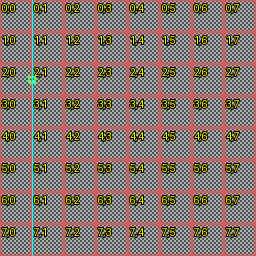
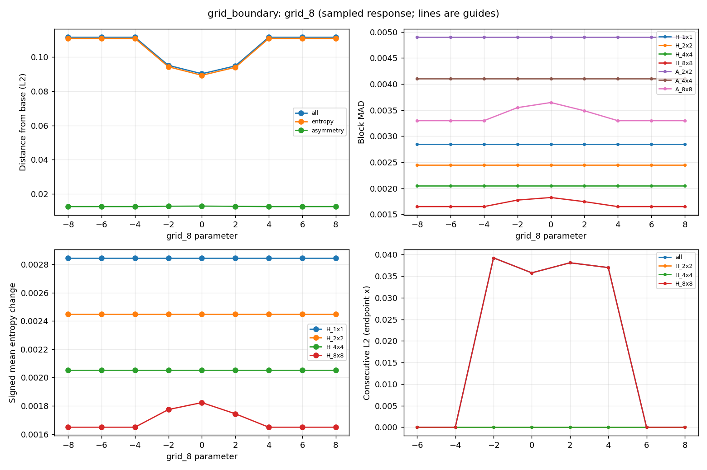

# Descriptor behavior — scientific unit tests of x94

## 1. Purpose

Estudiar `f(image) -> x94` antes de preguntar si separa clases reales. Se mide
qué cambia, cuánto, dónde y bajo qué condiciones. No hay entrenamiento,
clasificadores, métricas predictivas, datasets descargados ni selección de features.

Los números de este README son **medidos**, corrida del 1 de octubre de 2026:
256×256, B=16, seed=20261001, tolerancia=1e-6, Python 3.11.9, Pillow 12.3.0.
Hay 15 experimentos, 195 pares base/modificada y 84 comparaciones consecutivas:
**279 filas**. Las corridas complementarias 128×128 y reflexiones 257×257 están
separadas en `outputs/check_128/` y `outputs/check_257/`.

## 2. Why this experiment exists

Una representación determinista puede tener invariancias útiles y puntos ciegos.
Estos controles ayudan a distinguir una propiedad matemática de una expectativa
no comprobada. Ni mayor entropía significa estructura útil, ni mayor distancia
significa mayor probabilidad de defecto. El laboratorio termina antes de evaluar
capacidad predictiva.

Se revisaron AGENTS.md, README principal, inventario, documentación, código y
resultados existentes de understanding, especialmente 05 y 06. Los README de
entrada todavía enumeran solo 01–04; no se actualizaron porque el alcance está
limitado a 07. Se reutiliza 06, que a su vez usa Shannon E1 de 03 y asimetrías de 05.

## 3. Descriptor under test

`compare_descriptors.py` importa `understanding.06_entropy_pyramid_descriptor`
con `importlib`; **no implementa histograma, entropía ni asimetrías alternativas**.
También importa nombres y particiones de 06. Cada extracción exige 94 valores
finitos y coincidencia exacta de nombres/orden con su schema `x94-v1`.

| Bloque | Índices Python inclusivos | Dimensiones |
|---|---:|---:|
| H_1x1 | 0 | 1 |
| H_2x2 | 1–4 | 4 |
| H_4x4 | 5–20 | 16 |
| H_8x8 | 21–84 | 64 |
| A_2x2 | 85–87 | 3 |
| A_4x4 | 88–90 | 3 |
| A_8x8 | 91–93 | 3 |

Las entropías están en orden por filas: `entropy_8x8_r2_c1`, por ejemplo.
Las asimetrías siguen LR, TB, R180 en cada nivel: `asym_lr_8x8`, etc.
El vector usa **E=H/log2(B)**, no H en bits. Los encabezados H de las tablas
identifican bloques de entropía normalizada. Para cada transformación T,
`A_T(E)=sum(abs(E-T(E)))/g²`. Las nueve A son funciones de las otras 85 componentes;
hacen explícitas relaciones espaciales, pero no aportan información independiente.

## 4. Methodology

Cada caso genera su base, modifica una variable, extrae ambos vectores y conserva
`delta=modified-base`. Las comparaciones de movimiento añaden `relation=consecutive`
con base igual a la posición anterior, nunca a la imagen limpia. Las series
separan ejes, fronteras, transformaciones, métodos de resolución y configuraciones.

Las imágenes son uint8 L. Offsets, contraste, ruido y mezcla del defecto usan
`round` de Python (empates a par), seguido de clipping [0,255]. Contraste usa pivote
127.5. GaussianBlur usa Pillow, sin padding externo adicional. El tamaño geométrico
de defectos y los pasos se escalan por `round(px*size/256)` al cambiar `--size`;
offsets, sigmas, radios de blur y traslaciones globales mantienen sus unidades
originales. No interpretar distintas corridas como una misma escala física.

Cada CSV principal conserva parámetros, seed, bins de ambos vectores, resolución
de ambas imágenes, hashes SHA256 de píxeles L, rutas PNG, versiones, tolerancia,
vectores completos, deltas, top10, métricas por bloque y resultados auxiliares.
Los arrays/diccionarios dentro de CSV son JSON. No se redondean los floats al
exportarlos. Cada manifest incluye el orden completo y hashes del código de 07
y sus dependencias de 03/05/06. `case_id` más `relation` identifica la fila.

`results/response_curves.csv` resume curvas muestreadas; los puntos originales
están en cada CSV. `results/top_features.csv` y [observations.md](results/observations.md)
identifican hasta diez features del caso de mayor L2 de **cada serie y relación**.
Cada fila original tiene además su propio top10; si cambian menos de diez, no
se rellenan con ceros. Empates usan el orden canónico. Una curva plana o monótona
es una descripción de estas muestras y de la tolerancia, sin significancia
estadística. Líneas de gráficos solo guían la vista; no son interpolaciones medidas.

## 5. Comparison metrics

Para `d_i=y_i-x_i`: L1=`sum(abs(d))`, MAD=`L1/n`, L2=`sqrt(sum(d²))`, máximo
absoluto=`max(abs(d))`, changed=`count(abs(d)>tolerance)`. Se calculan para todo
x94, entropy-only, asymmetry-only y cada uno de los siete bloques. También se
guardan medias modificadas y cambios medios **con signo**, necesarios para
distinguir aumento de entropía de distancia a la base.

L1 favorece bloques con más componentes; MAD diluye cambios locales entre celdas
no afectadas; L2 y máximo responden de otra forma. Ninguna cifra por sí sola es
una conclusión. `changed` depende de la tolerancia y no mide relevancia práctica.

## 6. Synthetic scenes

`synthetic_scenes.py` genera una escena por coordenadas relativas `u=(x+.5)/N`,
`v=(y+.5)/N`: `118+48 sin(24πu)cos(16πv)+48u`, más `24 sin(64πv)` dentro de
`[.18,.43)×[.25,.62)`. Se redondea/clipea. Combina iluminación, textura y una
región asimétrica. Se evalúa esta fórmula directamente a cada resolución.

Los defectos usan damero de cuadrados 2×2 con intensidades 80/176 y una textura
objetivo IID uniforme uint8, seed fija. El target máximo se genera una vez por
experimento; tamaños menores recortan su esquina superior izquierda. Aumentar
el tamaño añade píxeles de la misma realización, sin volver a sortear el interior.
No se garantiza idéntico histograma empírico para crops de distinto tamaño.

El ruido aditivo usa `random.Random(seed).gauss(0,1)`: misma realización, multiplicada
por sigma. No se confunden variaciones de seed con amplitud. El control simétrico
usa coordenadas reflejadas para que **los píxeles** de la base sean LR y TB simétricos.
Las colisiones usan exactamente el mismo multiset de intensidades reordenado.

## 7. Global intensity

Offsets −40, −20, −10, 0, 10, 20, 40 sobre la escena texturizada. Ninguno produce
clipping en esta corrida. Los offsets no nulos cambian las 94 features: L2 va de
0.0495071 a 0.0699421, máximo por feature hasta 0.0157782. Para +10, L1=0.435026,
L2=0.0638893. La media de las 85 E cambia poco: 0.661343 original frente a
0.661201 con +10; ese promedio pequeño oculta cambios locales de signos opuestos.

**Interpretación:** sensibilidad pequeña pero medible, irregular respecto al
offset, debida aquí a cuantización, no clipping. −40 y +40 dan exactamente el
mismo descriptor porque difieren en 80 niveles (cinco bins), sin truncar el rango:
relabeling de counts conserva Shannon. No implica invariancia ante cualquier offset.
Los campos `entropy_*` y `asymmetry_*` permiten inspeccionar ambas partes por separado.

## 8. Contrast

Factores 0.5, 0.75, 1, 1.25, 1.5, 2. Las medias E son respectivamente
0.439472, 0.564391, 0.661343, 0.737648, 0.799456, 0.871990: aumento monótono
en estas muestras. La distancia a factor 1 es naturalmente no monótona al recorrer
todo el eje: 2.049819, 0.896264, 0, 0.704176, 1.274191, 1.971245 (L2).
Con factor 2, L1=18.208444, máximo=0.244352 y 94 cambios; se clipean 2661 píxeles.
Con 1.5 se clipean 16; factores menores no clipean.

Es coherente con ocupar más bins al expandir intensidades, pero no es una ley:
clipping, redondeo y redistribución pueden invertir la tendencia en otras imágenes.

## 9. Noise

| Sigma | L2 | Media E | Media A |
|---:|---:|---:|---:|
| 0 | 0 | 0.661343 | 0.015388 |
| 2 | 0.035127 | 0.663337 | 0.014826 |
| 5 | 0.114206 | 0.672310 | 0.013236 |
| 10 | 0.331030 | 0.696271 | 0.012243 |
| 20 | 0.920710 | 0.760364 | 0.010179 |
| 30 | 1.559438 | 0.829751 | 0.009451 |

Todas las medias por escala aumentan; a sigma 30 los aumentos en 1/2/4/8 son
0.133264/0.156346/0.166948/0.170076. Aquí las escalas finas responden más en media.
El ruido **eleva E y reduce A media**: puede aparentar más información y un mapa
más homogéneo sin mejorar estructura. Es una amenaza directa a interpretar
entropía como información estructural. Una seed no establece robustez estadística.

## 10. Blur

Radios 0,1,2,4,8 dan medias E 0.661343, 0.643915, 0.574524, 0.345861, 0.097408:
descenso coherente con pérdida de textura. L2 crece hasta 5.302272. Ya en radio 1
responden todos los niveles; no se puede atribuir un umbral de inicio diferente
con esta malla. Aumentos con signo en ese punto: −0.013983/−0.017696/−0.018367/
−0.017230 para 1/2/4/8. A radio 8, 8×8 pierde 0.588291 en media frente a 0.240249
global. **A media no es monótona:** baja hasta 0.002698 en radio 4 y sube a 0.049904
en radio 8. La imagen borrosa sigue teniendo gradiente y bordes de cuantización;
menos textura no implica mapa de entropía más simétrico.

## 11. Defect size

Defecto en (68,76), tamaños 4/8/16/24/32/48/64, fuerza 1. L2 aumenta
0.033173→0.111682→0.357363→0.600503→0.820125→1.356888→1.747660.
L1 aumenta 0.055113→6.558136; máximo 0.031463→0.749247; changed pasa de 13 a 27.
En estos crops el aumento no depende únicamente de contar más dimensiones:
también crece el cambio máximo. Los bloques gruesos reaccionan incluso al defecto
4×4, aunque menos que la celda fina afectada. Ver sección 21 para evitar confundir
L1 agregado con sensibilidad media de todas las celdas.

## 12. Defect strength

Misma caja 32×32 en (68,76), mismo target, mezcla `old+s*(target-old)`.
Fuerzas 0,.1,.2,.4,.6,.8,1 dan L2 0,0.357845,0.541177,0.684865,0.708775,
0.773496,0.820125. L1, L2 y máximo aumentan en estas muestras, pero no linealmente:
la subida 0.4→0.6 es pequeña frente a 0→0.1. No se fuerza monotonía ni se extrapola
a otras texturas. La mezcla cambia el histograma y cruza bins de manera discreta;
no basta este barrido para certificar suavidad entre puntos.

## 13. Defect position

Target fijo 16×16; `x=0,4,...,240`, `y=76`. Se guardan 61 comparaciones contra
base y 60 entre posiciones consecutivas. Hay **32 pasos consecutivos sin cambio
superior a tolerancia**, al permanecer el defecto dentro de celdas con el mismo
histograma de fondo. La mediana L2 de los pasos es cero.

Máximo paso: x=124→128, L2=0.135139, L1=0.279424, máximo por feature=0.109501,
15 cambios. Predominan `entropy_8x8_r2_c3` (−0.109501) y `...r2_c4` (+0.064984),
seguidos de celdas 4×4, 2×2 y A_LR. Una posición distinta puede ser invisible
dentro de una celda y visible al cruzarla: respuesta por tramos, dependiente del grid.
`largest_step` identifica máximos; `peak_over_3x_median` es solo una regla
descriptiva. Si la mediana es cero, marca cualquier paso > tolerancia y la razón
queda vacía, **no infinita**. No usar esa etiqueta como prueba estadística de pico.

## 14. Grid boundary sensitivity

Prueba crítica: target 8×8, y=76 fijo, **centro** del defecto en b−8,b−6,...,b+8.
Se usan primeras fronteras internas: b=128 (2×2), b=64 (4×4), b=32 (8×8).
Fronteras completas: 2×2 `{0,128,256}`; 4×4 `{0,64,128,192,256}`;
8×8 `{0,32,64,96,128,160,192,224,256}`. Se importan las cajas exactas de 06.
La frontera gruesa también es frontera de los niveles finos; no atribuir todo
el cambio del caso 2×2 a sus cuatro features.

| Frontera | Mayor paso L2 | L1 | Max feature | Changed | Escalas de entropía que cambian |
|---|---:|---:|---:|---:|---|
| 2×2, x=128 | 0.041391 | 0.084750 | 0.031463 | 15 | 2×2, 4×4, 8×8 |
| 4×4, x=64 | 0.041069 | 0.073369 | 0.031463 | 10 | 4×4, 8×8 |
| 8×8, x=32 | 0.039253 | 0.055680 | 0.031463 | 5 | 8×8 |

Los mayores pasos van de offset −4 a −2: el borde delantero empieza a entrar
en la siguiente celda, **antes de que cruce el centro**. En x=32, los responsables
son `entropy_8x8_r2_c1` (+0.0314634), `...r2_c0` (−0.0234666) y las tres A_8x8
(+0.000249902 cada una). H_1x1, H_2x2 y H_4x4 no cambian entre esas posiciones.
Los top10 de las otras fronteras están en [observations.md](results/observations.md).

La distancia a base cuando el defecto está totalmente dentro de una celda es
0.111682. Centrado en x=32 baja a 0.090276, aproximadamente 19.2% menos, aunque
la textura/área del defecto es idéntica; centrado en x=128 baja a 0.087306.
Las distancias por paso tienen mesetas cero y picos alrededor del reparto entre
celdas. Los máximos son aproximadamente 2.19 veces la mediana de este barrido.
**Hay sensibilidad relevante a alineación en este control; no se demuestra una
discontinuidad de una función continua ni que el efecto sea industrialmente extremo.**
Todo ocurre en una malla de píxeles finita. No ocultar la caída de respuesta.

Comprobación manual independiente: centro x=32, caja `[28,76,36,84)`. Intersecta
solo r2c0 y r2c1 en 8×8, con 32 píxeles en cada una. Cada celda tenía 512 valores
80 (bin5) y 512 valores 176 (bin11). El test resta los píxeles retirados y suma
los del target, calcula `-sum(p log2 p)/4` y lo contrasta con 06 a 14 decimales.
Counts y valores están en [boundary_manual_check.json](results/boundary_manual_check.json).
Se inspeccionaron visualmente la posición y la curva guardadas abajo.




## 15. Translation sensitivity

Desplazamientos horizontales y verticales 0,1,2,4,8,16 px. Política **zero padding**:
se descarta contenido saliente y se rellena con cero el entrante. Por ello mide
traslación **más el efecto de esta política de borde**, no traslación ideal sin
pérdida. L2 horizontal: 0,0.108513,0.161443,0.200973,0.162329,0.273493;
vertical: 0,0.083393,0.120755,0.158352,0.184208,0.261543.
Horizontal no monótona; vertical monótona en estas muestras. No hay invariancia.
Los CSV separan cambios H/A y por escala, incluidos los provocados en bordes.

## 16. Reflection and rotation behavior

En 256×256, E se **permuta exactamente** al reflejar LR/TB o rotar 180°; su
orden en el vector cambia. L2 de x94 frente al original: 0.290573/0.158064/0.290573.
Las nueve A se conservan exactamente, así como suma y norma L2 de las 85 E.
Error máximo frente a la permutación predicha: cero en los tres casos.

Matemáticamente, para particiones compatibles con reflexión, `E(TI)=T E(I)`.
LR/TB/R180 son permutaciones conmutativas. Para cualquiera de ellas S y T:
`A_T(S E)=||S E - T S E||_1/g²=||S(E-T E)||_1/g²=A_T(E)`.
Las normas de E se conservan porque S permuta componentes; el vector espacial
completo **no** tiene por qué permanecer igual. No se afirma esto para rotación 90°.

**Excepción medida:** en 257×257 las fronteras floor no forman parejas espejo
de igual geometría. Errores máximos frente a permutación ideal LR/TB/R180:
0.004791/0.004649/0.008998. Cambios máximos en A: 0.002433/0.000852/0.002439.
Ver [corrida 257](outputs/check_257/results/transformations.csv). Es consecuencia
de la partición actual; no se modificó para restaurar la invariancia.

## 17. Symmetric vs asymmetric defects

Base pixel-simétrica. Dos targets 16×16, y=64: uno en x=48 y el espejo en x=192
frente a dos del lado izquierdo en x=48 y x=80. Ambos reemplazan 512 píxeles,
con la misma pareja de texturas (la segunda reflejada). Un tercer control usa
solo el primero, 256 píxeles, y **no** se presenta como igualdad de área.

| Caso | A_LR 2×2 | A_LR 4×4 | A_LR 8×8 | L2 total |
|---|---:|---:|---:|---:|
| Pareja espejo | 0 | 0 | 0 | 0.506737 |
| Dos a la izquierda | 0.031434 | 0.028026 | 0.020916 | 0.509976 |

Las distancias totales son parecidas, pero las A_LR distinguen el layout de
entropías. La pareja espejo es simétrica **LR**, no TB ni R180: sus residuos TB
y R180 permanecen positivos. Esto caracteriza las nueve relaciones y evita
interpretar A=0 como imagen sin anomalía o detector universal de simetría de píxeles.

## 18. Same entropy, different structure

**Experimento 12:** en cada celda 8×8 de la pirámide se colocan franjas verticales
0/255; la segunda imagen ordena exactamente esos mismos valores, produciendo
una división horizontal dentro de cada celda. Se verifican histogramas de 256
counts idénticos en **todas** las celdas de los cuatro niveles; el anidamiento
preserva también los histogramas gruesos. Ambas imágenes dan exactamente el
mismo x94: L1=L2=máximo=changed=0. Todas las E=.25 y todas las A=0 a B=16.
Se confirma la colisión también con 8/32/64/128/256 bins.

**Shannon entropy does not encode spatial arrangement inside a cell.**
Si una permutación π solo reorganiza píxeles dentro de cada celda más fina,
`hist(C)=hist(πC)`, luego `E(C)=E(πC)`; el vector completo y sus A coinciden.
Ni siquiera hace falta igualdad de histogramas para compartir una entropía,
pero aquí se construye una condición suficiente exacta y verificable.

**Experimento 13:** dos patches 32×32 con exactamente 512 ceros y 512 valores
255: columnas alternadas frente a mitad superior negra e inferior blanca.
El histograma y H global=1 bit son idénticos. Como imágenes independientes,
sus pirámides sí difieren (L2=2.291288), porque las subdivisiones interiores ven
histogramas diferentes. Al pegarlos en una misma celda fina completa (r2c2 o
r3c5), ambos embeddings colisionan exactamente. Al colocarlos cruzando fronteras
en `[48,48,80,80)`, L2=0.130260: la partición revela parte de la estructura.
No confundir igualdad de H global con igualdad garantizada de x94.

Programáticamente se compara `Image.histogram()` completo y `entropy_details`
importado de 06; se conservan las 85 comparaciones locales en `extras`.

## 19. Resolution

Se compara siempre contra la escena nativa a resolución `--size` (256 por defecto).
Las escenas nativas 128/256/512 se calculan desde coordenadas relativas, **sin
resize**. La segunda familia redimensiona el mismo archivo base con NEAREST o
BILINEAR explícitos. Geometría relativa y frecuencias de la escena nativa se
mantienen, pero el muestreo cambia.

| Tamaño | L2 nativa | L2 resize nearest | L2 resize bilinear |
|---:|---:|---:|---:|
| 128 | 0.053073 | 0.031842 | 0.176780 |
| 256 | 0 | 0 | 0 |
| 512 | 0.020998 | 0 | 0.049522 |

Nearest 256→512 replica cada píxel 2×2 y mantiene probabilidades en celdas
alineadas: invariancia exacta en este caso. No es prueba de invariancia de
resolución nativa. Bilinear altera intensidades y puede desplazar bins, como se
mide. Todas las imágenes generan 94 features, pero dimensión fija no implica
estabilidad de valores.

## 20. Number of histogram bins

Se prueban 8/16/32/64/128/256 en escena, damero, ruido IID y defecto. Las series
`stability_*` comparan **la misma imagen** contra B=16; cambian cuantización y
denominador. `defect_discrimination` y `collision_discrimination` comparan dos
imágenes con **el mismo B**. No mezclar ambas preguntas ni llamarlas clasificación.

El damero conserva H=1 bit para todos los B, mientras E baja de 1/3 a 1/8.
La media E de ruido IID baja de 0.998747 (B8) a 0.980940 (B256), por ocupación
finita de bins, aun cuando H global aumenta de 2.999891 a 7.996612 bits.
La distancia damero/defecto es 0.331728,0.357363,0.358192,0.343578,0.328021,
0.307607: más bins no aumentan necesariamente la separación numérica.
La colisión estructural sigue dando cero en todos los B.

Rango teórico H≤log2(B), E≤1; si una celda tiene N<B, la cota efectiva es
`log2(min(B,N))/log2(B)`. Conceptualmente hay B counts/probabilidades por celda;
no se miden tiempos ni RAM, y no se hacen afirmaciones de eficiencia.
B bajo fusiona intensidades; B alto exige más muestras por celda. Serían usos
problemáticos comparar valores entre B como si compartieran escala semántica,
o esperar que B256 resuelva la colisión. Estas pruebas **no identifican un B
universalmente incorrecto ni eligen el definitivo**; falta evidencia de la tarea.

## 21. Multiscale response

Cambio agregado **L1** por nivel (el CSV conserva además MAD, L2, máximo y count):

| Defect size | 1×1 | 2×2 | 4×4 | 8×8 |
|---:|---:|---:|---:|---:|
| 4 | 0.000790 | 0.002762 | 0.009459 | 0.031463 |
| 8 | 0.002847 | 0.009798 | 0.032822 | 0.105529 |
| 16 | 0.010379 | 0.034808 | 0.112102 | 0.334659 |
| 24 | 0.021370 | 0.070185 | 0.217973 | 0.680203 |
| 32 | 0.034987 | 0.112789 | 0.337273 | 1.204815 |
| 48 | 0.070438 | 0.218822 | 0.591092 | 2.320369 |
| 64 | 0.114459 | 0.401609 | 1.081399 | 3.986299 |

Para 4×4 hay una celda afectada por nivel, de modo que el máximo fino es mayor.
Pero **MAD sobre todas las celdas decrece**: 0.000790/0.000690/0.000591/0.000492.
Decir «8×8 es más sensible» sin definir agregación sería ambiguo. Las escalas
gruesas también responden y crecen con tamaño; las finas localizan mejor la caja.

Localidad: `expected_affected_cells` incluye todas las intersecciones geométricas,
no solo la celda del centro. Se compara con `most_affected_entropy_cell` y se
comprueba que las celdas cambiadas son un subconjunto del soporte esperado.
Los siete tamaños y las seis fuerzas no nulas dan match; fuerza cero queda null.
En movimiento y fronteras, todos los casos con respuesta > tolerancia coinciden
con su soporte (incluida unión de caja vieja/nueva para pasos); no hubo mismatch.
No se exige cambio en toda celda intersectada: puede existir colisión de entropía.
No se aplica localidad de píxeles a A, que agrega parejas por todo el mapa.

## 22. Important observed invariances

- Reordenamiento que preserva histogramas en cada celda fina: colisión exacta.
- Reflexiones/180°: A y normas de E invariantes a 256×256, con E permutada.
- Replicación nearest 2× con grids alineados: probabilidades y x94 conservados.
- Algunos movimientos dentro de celdas sobre fondo balanceado son invisibles.
- Relabeling de bins por ciertos offsets sin clipping conserva E; no cualquier offset.

Estas propiedades son condicionales. Algunas pueden ser útiles y otras eliminar
información necesaria; no se clasifican como ventajas universales.

## 23. Important observed sensitivities

Contraste, ruido, blur, magnitud del defecto, frontera, traslación con padding,
interpolación y bins cambian x94. Hay respuesta monótona de L1/L2 al tamaño y
fuerza en este fixture; A bajo blur es no monótona. A bajo reflexión deja de ser
exactamente invariante en tamaño no divisible. Diferencias globales pequeñas
pueden coexistir con muchas features cambiadas o con cancelación de signos.

## 24. Failure modes

Colisiones estructurales completas; ausencia de respuesta al movimiento interno;
respuesta distinta al mismo defecto por alineación; entropía alta por ruido;
asimetría de entropías cero aunque la estructura no sea espejo; pérdida de
invariancia por particiones floor desiguales; sensibilidad al preprocesado.
Las nueve A no pueden recuperar una estructura ya perdida por las 85 entropías.
La representación incluye ubicación absoluta: no es un descriptor invariante a traslación.

## 25. Threats to validity

### Synthetic data

Estos experimentos NO demuestran rendimiento sobre defectos industriales reales.
Pocas familias de imágenes y una seed favorecen controles, no cobertura representativa.
Una realización fija elimina un confusor, pero no estima variabilidad entre muestras.

### No predictive evaluation

No se mide accuracy, F1, AUROC ni classification capability. Una distancia mayor
no prueba separación de clases, utilidad de A ni relevancia del supuesto defecto.

### Shannon entropy limitation

Dos patrones diferentes pueden tener el mismo histograma y la misma entropía.
El control exacto establece un punto ciego; no cuantifica su frecuencia en datos reales.

### Grid dependence

La representación depende de fronteras, alineación y resolución. Aquí se examina
movimiento horizontal del defecto; no se cubren todas las fases verticales,
orientaciones, tamaños o formas. Las fronteras gruesas pertenecen también a grids finos.

### Quantization

Bins y denominador cambian resultados. Las curvas discretas y la tolerancia
pueden ocultar variaciones pequeñas; no se prueban continuidad ni significancia.

### Image preprocessing

Resize, clipping, normalización y redondeo pueden alterar el descriptor.
No se normaliza automáticamente cada imagen. La traslación incluye padding negro;
el blur conserva el tratamiento de bordes de Pillow. Versiones distintas pueden
cambiar redondeo o filtros; se registran versiones y hashes.

## 26. Implications for the paper

### Desirable behavior

En estos controles aumentan L1/L2/máximo al crecer tamaño/fuerza; cambios locales
se localizan en las celdas intersectadas; A_LR reacciona al romper LR con área
de anomalía controlada. Son propiedades observadas, todavía sin utilidad predictiva probada.

### Neutral behavior

Orden espacial explícito, E normalizada, A determinista/redundante, permutación
bajo reflexión y dimensión fija. El resultado depende de la agregación elegida.

### Potential weakness

Colisiones exactas, sensibilidad a ruido y ubicación respecto al grid, falta de
robustez a traslación con esta política, ambigüedad de A baja, preprocesado y
resoluciones impares. No llamar «extrema» a la sensibilidad de frontera sin
un criterio de relevancia externo; reportar sus magnitudes y la caída medida.

### Requires validation with real data

Toda relevancia industrial: qué perturbaciones son nuisance o señal, cuánto
afecta la alineación, utilidad adicional de A, bins apropiados y comparación
contra descriptores que sí codifiquen estructura interna. Nada de esto se resuelve aquí.

## 27. Questions that remain open

Variación entre seeds/texturas; fases verticales; defectos de otra forma; rangos
de iluminación más amplios con clipping; otras políticas de borde; tolerancias
con significado físico; refinamiento de curvas entre muestras. ¿Qué colisiones
son frecuentes y qué invariancias son deseables en la tarea futura? No se cambia
la definición matemática para responderlas en este laboratorio.

## 28. How to run

Desde la raíz, Python existente y sin instalaciones:

```powershell
Set-Location D:\Publications\2026-10-Symmetry-Entropy
.\code\.venv\Scripts\python.exe .\code\understanding\07_descriptor_behavior\run_all.py
.\code\.venv\Scripts\python.exe .\code\understanding\07_descriptor_behavior\run_all.py --experiment grid_boundary
.\code\.venv\Scripts\python.exe .\code\understanding\07_descriptor_behavior\run_all.py --experiment defect_size
.\code\.venv\Scripts\python.exe .\code\understanding\07_descriptor_behavior\run_all.py --help
.\code\.venv\Scripts\python.exe .\code\understanding\07_descriptor_behavior\tests\test_behavior_helpers.py
.\code\.venv\Scripts\python.exe .\code\understanding\06_entropy_pyramid_descriptor\tests\test_descriptor.py
.\code\.venv\Scripts\python.exe -m pip check
```

La secuencia solicitada con activación también funciona:

```powershell
cd D:\Publications\2026-10-Symmetry-Entropy\code
.\.venv\Scripts\Activate.ps1
cd understanding\07_descriptor_behavior
python run_all.py
python run_all.py --experiment grid_boundary
python run_all.py --experiment defect_size
python run_all.py --help
```

Parámetros: `--size` (cuadrada, mínimo 128 para estos fixtures), `--bins` (2…256),
`--seed`, `--tolerance`, `--experiment`, `--output`. El extractor en sí acepta tamaños
menores; el mínimo 128 pertenece a este diseño experimental. No hay nuevos paquetes.
Pillow/stdlib generan escenas y CSV; matplotlib **si ya está instalado** genera
plots. Si falta, se omiten plots sin instalarlo; permanecen imágenes y medidas.

`--output` debe resolver dentro de 07; usar una subcarpeta nueva para preservar
corridas. Repetir una configuración en el mismo destino reemplaza sus archivos
homónimos. Una ejecución parcial actualiza solo su CSV/manifest/figuras y no
reescribe resúmenes globales; no mezclar parámetros distintos en el destino principal.
Los tests de artefactos requieren primero la corrida **default** en este directorio.

```powershell
.\code\.venv\Scripts\python.exe .\code\understanding\07_descriptor_behavior\run_all.py --size 128 --output .\code\understanding\07_descriptor_behavior\outputs\check_128
.\code\.venv\Scripts\python.exe .\code\understanding\07_descriptor_behavior\run_all.py --experiment transformations --size 257 --output .\code\understanding\07_descriptor_behavior\outputs\check_257
```

Código: `run_all.py` (CLI/exportación/gráficos), `experiments.py` (15 protocolos
agrupados para evitar archivos diminutos), `synthetic_scenes.py`, `perturbations.py`,
`compare_descriptors.py`, `tests/test_behavior_helpers.py`. Todo permanece en 07.

CSV principales: `global_intensity`, `contrast`, `noise`, `blur`, `defect_size`,
`defect_strength`, `defect_position`, `grid_boundaries`, `translation`,
`transformations`, `symmetric_vs_asymmetric`, `same_entropy_different_structure`,
`same_histogram`, `resolution`, `bins`. Los tres CSV auxiliares son
`response_curves`, `top_features` y `multiscale_response`. Imágenes base/modificada
y overlays: `outputs/images/<experimento>/`; gráficos: `outputs/plots/`.
Rojo=grid, verde=caja, cyan=frontera. Los overlays nunca alimentan el extractor.

Validación: 15 tests de 07 y 25 de 06 pasan; `pip check` sin requisitos rotos.
Se regeneran todas las imágenes y vectores default desde sus seeds y se exige
igualdad exacta contra CSV/PNG; se verifican métricas, top10, 94 dimensiones,
schema, colisiones y count arithmetic independiente. Se ejecutó además la suite
completa a 128 y reflexiones a 257. No se evaluó GPU: este laboratorio es escalar
CPU/Pillow y no cambia el entorno. La carpeta no contiene metadatos Git; no
se pudo usar `git diff`. No hubo fallos de ejecución ni cambios de dependencias.
