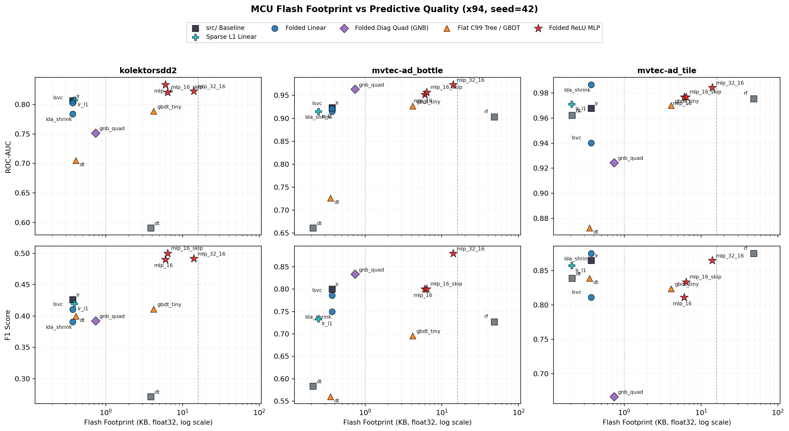
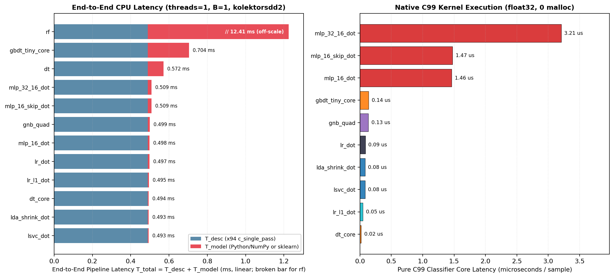
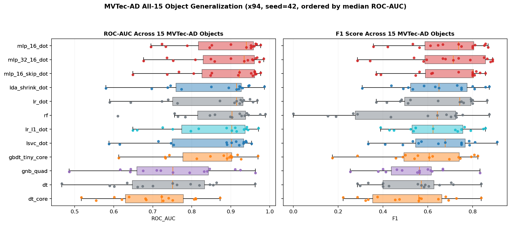
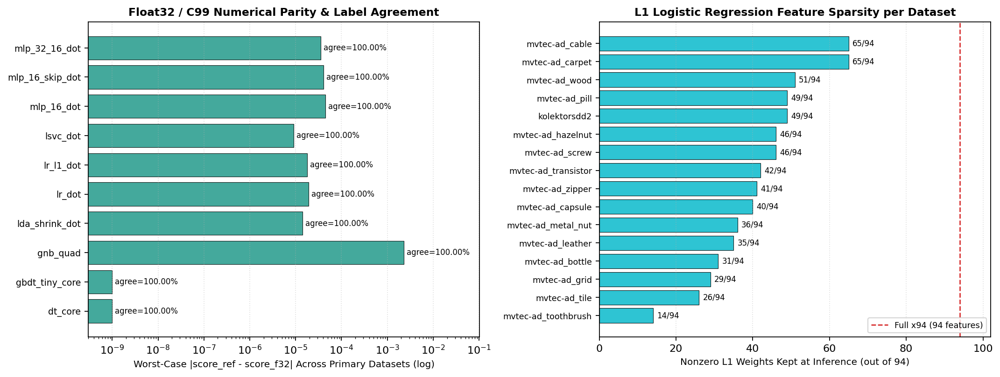

# Lab 14 — Clasificadores ML ligeros y núcleos C99 portables a MCU sobre $\mathbf{x}_{94}$

**Estado:** Exploración experimental y portabilidad a C99 validada en `understanding/14_ml_classifiers_mcu/` (`src/` **no ha sido modificado**; todos los resultados primarios y del barrido multi-objeto reutilizan las particiones canónicas `seed=42` de [`src/models/descriptor_classifier.py`](../../src/models/descriptor_classifier.py)).

---

## 1. Objetivo científico y alcance

En el código formal (`src/`), únicamente `lr_dot` pliega el `StandardScaler` dentro de un núcleo aritmético sin dependencia de `sklearn`; `lr`, `dt`, `knn` y `rf` ejecutan el estimador completo en Python. Este laboratorio responde dos preguntas antes de promover cualquier modelo a `src/`:

1. **¿Qué arquitecturas ML no lineales o dispersas mejoran a `lr_dot` y `rf` en $\mathbf{x}_{94} \in [0, 1]^{94}$?**
2. **¿Cuál es su coste real al portarse a C99 puro (`float32`, cero `malloc`, cero llamadas a `<math.h>` en el umbral) dentro del presupuesto total de latencia $T_{\text{total}} = T_{\text{desc}} + T_{\text{model}}$?**

### Familias evaluadas (`configs/understanding/ml_classifiers_mcu.toml`)

| Familia | Modelos | Cómo se pliega al núcleo C99 (`float32`) | MACs | Scratch SRAM | `<math.h>` umbral |
| :--- | :--- | :--- | :---: | :---: | :---: |
| Baseline `src/` | `lr_dot`, `dt`, `rf` | `lr_dot` pliega escala a dot product `94+1`; `dt`/`rf` corren como referencia `src/` | `94` (`lr_dot`) / `0` (`dt`, `rf`) | `0 B` | `0` |
| Lineal disperso (L1) | `lr_l1_dot` | Pliega `StandardScaler` y almacena solo índices `nnz` no nulos `b + Σ w_nz[k]*x[idx[k]]` | `nnz ≤ 94` | `0 B` | `0` |
| Lineales plegados | `lda_shrink_dot`, `lsvc_dot` | `LDA(lsqr, shrinkage="auto")` y `LinearSVC` plegados en `w·x + b` | `94` | `0 B` | `0` |
| Cuadrático diagonal | `gnb_quad` | Log-likelihood ratio de `GaussianNB` reducido analíticamente a `c + Σ x_i·(a_i·x_i + b_i)` | `188` (`2d`) | `0 B` | `0` (`log/exp` eliminados) |
| Árboles en tabla plana | `dt_core`, `gbdt_tiny_core` | Tablas estáticas `offsets/features/thresholds/left/right/leaf_values` | `0` | `0 B` | `0` |
| MLPs ReLU plegados | `mlp_16_dot`, `mlp_16_skip_dot`, `mlp_32_16_dot` | Absorbe `StandardScaler` en la primera capa lineal (y en el skip lineal de `mlp_16_skip_dot`): `W_eff[j,i] = W[j,i] / σ_i`, `b_eff = b - W_eff·μ` | `1,520` / `1,614` / `3,536` | `64 B` / `64 B` / `192 B` | `0` (decisión `z > 0.0f`) |

> [!NOTE]
> **Por qué 0 llamadas a `<math.h>` en la decisión:** En todos los modelos continuos, la regla binaria `sigmoid(z) > 0.5` equivale exactamente a comparar el logit crudo `z > 0.0f`. Solo si un sistema requiere probabilidad calibrada explícita fuera del umbral necesitaría evaluar `expf()`.

---

## 2. Resultados medidos en datasets primarios (`seed=42`, CPU `threads=1`, `B=1`)

Resultados registrados en [`outputs/benchmark_primary_models.csv`](outputs/benchmark_primary_models.csv) con backend descriptor `c_single_pass` (`T_desc(B=1) = 0.489 ms` en `kolektorsdd2`, `0.281 ms` en `mvtec-ad_bottle`, `0.357 ms` en `mvtec-ad_tile`; `T_desc(B=32) = 0.040 ms`, `0.033 ms`, `0.053 ms`):

### A. KolektorSDD2 (normal, `N_test=1,004`, `110` defectos)

| Modelo | F1 | ROC-AUC | PR-AUC | Flash (`float32`) | `T_model` Python (`B=1`) | Kernel C99 ($\mu\text{s}$/img) | $T_{\text{total}}$ (`B=1`, ms) |
| :--- | :---: | :---: | :---: | :---: | :---: | :---: | :---: |
| `lr_dot` (`src/`) | `0.4265` | `0.8061` | `0.4360` | `0.37 KB` (`380 B`) | `0.0081 ms` | `0.086 us` | `0.4975 ms` |
| `dt` (`src/`) | `0.2716` | `0.5908` | `0.1766` | `3.85 KB` | `0.0827 ms` | — | `0.5720 ms` |
| `rf` (`src/`) | `0.4298` | `0.7904` | `0.4223` | `181.36 KB` | `11.9226 ms` | — | `12.4120 ms` |
| `lr_l1_dot` (`49/94`) | `0.4195` | `0.8075` | `0.4366` | `0.39 KB` (`396 B`) | `0.0061 ms` | `0.046 us` | `0.4955 ms` |
| `lda_shrink_dot` | `0.3910` | `0.7839` | `0.3814` | `0.37 KB` | `0.0038 ms` | `0.082 us` | `0.4932 ms` |
| `lsvc_dot` | `0.4107` | `0.8027` | `0.4294` | `0.37 KB` | `0.0037 ms` | `0.081 us` | `0.4931 ms` |
| `gnb_quad` | `0.3923` | `0.7514` | `0.2960` | `0.74 KB` (`756 B`) | `0.0098 ms` | `0.134 us` | `0.4992 ms` |
| `dt_core` | `0.4000` | `0.7051` | `0.2542` | `0.41 KB` (`418 B`) | `0.0049 ms` | **`0.019 us`** | `0.4943 ms` |
| `gbdt_tiny_core` | `0.4112` | `0.7884` | `0.3890` | `4.19 KB` (`4288 B`) | `0.2150 ms` | `0.138 us` | `0.7043 ms` |
| `mlp_16_dot` | `0.4904` | **`0.8334`** | **`0.5936`** | `6.00 KB` (`6148 B`) | `0.0090 ms` | `1.462 us` | `0.4984 ms` |
| `mlp_16_skip_dot` | **`0.5000`** | `0.8207` | `0.5519` | `6.37 KB` (`6524 B`) | `0.0195 ms` | `1.475 us` | `0.5089 ms` |
| `mlp_32_16_dot` | `0.4917` | `0.8225` | `0.5547` | `14.00 KB` (`14340 B`) | `0.0195 ms` | `3.206 us` | `0.5089 ms` |

- En **KolektorSDD2**, `mlp_16_skip_dot` sube **+7.35 puntos F1** respecto a `lr_dot` (`0.5000` vs `0.4265`) y `mlp_16_dot` sube **+15.75 puntos PR-AUC** (`0.5936` vs `0.4360`) con solo `6.00–6.37 KB` de Flash y `< 1.5 us` en C99.
- En la modalidad **invertida** (`kolektorsdd2-inverted`), los tres MLPs mantienen la mejora (`F1 = 0.4852–0.4915`, `ROC-AUC = 0.8311–0.8391`, `PR-AUC = 0.5681–0.5964` vs `lr_dot` `0.4153 / 0.8151 / 0.4850`).

### B. MVTec-AD `bottle` y `tile` (normal e invertido)

- **`mvtec-ad_bottle` (normal):** `mlp_32_16_dot` alcanza **`F1=0.8800`, `ROC-AUC=0.9732`, `PR-AUC=0.9478`** (`14.00 KB`, `4.02 us` C99) frente a `lr_dot` (`0.8000 / 0.9231 / 0.8963`) y `rf` (`0.7273 / 0.9030 / 0.8266`); `gnb_quad` sorprende con **`0.8333 / 0.9632 / 0.9254`** usando solo `0.74 KB` (`0.135 us` C99). En `bottle-inverted`, `mlp_32_16_dot` sube a `F1=0.9231`, `ROC-AUC=0.9716`.
- **`mvtec-ad_tile` (normal):** el bloque lineal ya es casi óptimo: `lda_shrink_dot` logra **`F1=0.8750`, `ROC-AUC=0.9867`, `PR-AUC=0.9483`** (`0.37 KB`, `0.083 us`), y `lr_l1_dot` conserva `F1=0.8571`, `ROC-AUC=0.9711` usando solo **26/94 features (`0.21 KB`, `0.040 us`)**. `mlp_32_16_dot` obtiene `F1=0.8649`, `ROC-AUC=0.9845`, **`PR-AUC=0.9582`**. (En `tile-inverted`, las métricas puntuales coinciden exactamente porque la simetría de entropía/asimetría es casi invariante por inversión de polaridad.)

---

## 3. Generalización multi-objeto (todos los 15 objetos de MVTec-AD)

Promedio sobre los **15 objetos MVTec-AD** ([`outputs/mvtec15_aggregate_summary.csv`](outputs/mvtec15_aggregate_summary.csv) y [`outputs/all_objects_quality.csv`](outputs/all_objects_quality.csv)):

| Modelo | F1 Medio (± std) | F1 Mediano | ROC-AUC Medio | ROC-AUC Mediano | PR-AUC Medio | Flash Medio (KB) | Features activas |
| :--- | :---: | :---: | :---: | :---: | :---: | :---: | :---: |
| **`mlp_16_skip_dot`** | **`0.6905 ± 0.1623`** | **`0.8000`** | `0.8822` | `0.9222` | **`0.7847`** | `6.37 KB` | `94.0` |
| **`mlp_32_16_dot`** | `0.6868 ± 0.1914` | `0.7143` | **`0.8840`** | `0.9341` | `0.7823` | `14.00 KB` | `94.0` |
| **`mlp_16_dot`** | `0.6849 ± 0.1611` | `0.7368` | `0.8802` | **`0.9397`** | `0.7790` | `6.00 KB` | `94.0` |
| `lsvc_dot` | `0.6505 ± 0.1632` | `0.6780` | `0.8422` | `0.9019` | `0.7243` | `0.37 KB` | `93.7` |
| `lr_dot` (`src/`) | `0.6486 ± 0.1667` | `0.7429` | `0.8493` | `0.9146` | `0.7333` | `0.37 KB` | `93.7` |
| `lda_shrink_dot` | `0.6479 ± 0.1675` | `0.6500` | `0.8513` | `0.9147` | `0.7270` | `0.37 KB` | `93.7` |
| `lr_l1_dot` | `0.6337 ± 0.1563` | `0.6230` | `0.8498` | `0.9026` | `0.7094` | **`0.32 KB`** | `41.1 / 94` |
| `gbdt_tiny_core` | `0.5886 ± 0.1902` | `0.6061` | `0.8445` | `0.8905` | `0.6996` | `4.10 KB` | `56.0` |
| `gnb_quad` | `0.5379 ± 0.1432` | `0.5625` | `0.7571` | `0.7514` | `0.5566` | `0.74 KB` | `94.0` |
| `dt` (`src/`) | `0.5303 ± 0.1659` | `0.5714` | `0.7322` | `0.7511` | `0.4931` | `0.19 KB` | `6.3` |
| `rf` (`src/`) | `0.5178 ± 0.2711` | `0.6429` | `0.8706` | `0.9030` | `0.7372` | `67.49 KB` | `92.6` |
| `dt_core` | `0.5164 ± 0.1825` | `0.5600` | `0.7024` | `0.7231` | `0.4582` | `0.32 KB` | `10.3` |

Observaciones clave del barrido multi-objeto:
1. **Los MLPs plegados ganan consistentemente sin inflar Flash:** `mlp_16_skip_dot` supera a `lr_dot` en `+4.19` pts de F1 medio, `+3.29` pts de ROC-AUC medio y `+5.15` pts de PR-AUC medio, ocupando `< 6.4 KB` (**10.6x menos Flash que `rf`**).
2. **`rf` sufre colapso de umbral sin calibrar en desbalanceo:** En `transistor`, `rf` obtiene `ROC-AUC = 0.9227` pero `F1 = 0.0000` con el corte fijo `p > 0.5`; los MLPs entrenados con `BCEWithLogitsLoss(pos_weight)` evitan este colapso (`F1 = 0.7368`, `ROC-AUC = 0.9659`).
3. **L1 reduce >50% de pesos lineales:** `lr_l1_dot` conserva solo `41.1/94` features en promedio (`14/94` en `toothbrush`, `26/94` en `tile`, `31/94` en `bottle`, `49/94` en `kolektorsdd2`, `65/94` en `cable`/`carpet`) manteniendo `ROC-AUC` medio virtualmente idéntico a `lr_dot` (`0.8498` vs `0.8493`).

---

## 4. Paridad numérica, descubrimiento en `float32` y latencia real

- **Acuerdo de clasificación perfecto:** En todas las filas primarias (`144`) y del barrido (`192`), `pred_agreement_f32 = 1.000000` y `pred_agreement_c99 = 1.000000` (cero discrepancias de etiqueta entre referencia, `float64`, `float32` y C99).
- **Hallazgo IEEE-754 `float32` en `gnb_quad`:** Matemáticamente en `float64`, el plegado cuadrático coincide con `sklearn.GaussianNB._joint_log_likelihood` con error `<= 6.91e-12` (`0.000000` mostrado a `1e-6`). Sin embargo, al expandir `(x_i - μ_i)^2 / v_i` respecto a `0`, el término constante `c` absorbe sumas de hasta `+1198.7` (`kolektorsdd2`), `+8973.6` (`bottle`) y `+11005.9` (`tile-inverted`), cancelándose con términos de signo opuesto hasta scores `O(10)`. Como 1 ULP de `float32` alrededor de `11,005` vale `~9.77e-4`, la acumulación secuencial en C99 difiere de NumPy hasta `0.005859` (~6 ULPs, aún con `100%` de acuerdo en predicción). Para MCU de precisión simple, esto demuestra que el orden y centrado importan en `GaussianNB`, mientras que `lr_dot`, `lr_l1_dot`, `lda_shrink_dot`, `lsvc_dot` y los tres MLPs se mantienen siempre por debajo de `<= 8.25e-5`.
- **Desbalance Python vs C99 en árboles:** `gbdt_tiny_core` tarda `0.215 ms` en el bucle escalar Python (`B=1`, `kolektorsdd2`), pero en C99 compilado con `cl.exe /O2` tarda **`0.138 us` (~1,556x más rápido)** — una lección directa sobre no juzgar árboles pequeños por latencia de bucles Python. Todos los modelos portados (`0.019–4.02 us`) son `< 1.5%` de `T_desc(B=1)` (`0.28–0.49 ms`), por lo que **`T_desc` sigue siendo el cuello de botella dominante en el pipeline completo** ([`outputs/statistical_comparisons.csv`](outputs/statistical_comparisons.csv)).

---

## 5. Visualizaciones y artefactos generados









- Header C99 auto-generado de ejemplo para `mvtec-ad_bottle`: [`outputs/sample_weights_mvtec_bottle.h`](outputs/sample_weights_mvtec_bottle.h)
- Prototipos C99 embebibles (`0 malloc`, `0 <math.h>`): [`c_kernels/mcu_classifiers.h`](c_kernels/mcu_classifiers.h) y [`c_kernels/mcu_classifiers.c`](c_kernels/mcu_classifiers.c)
- Metadatos de ejecución y compilador (`MSVC 19.51.36244 x64`): [`outputs/run_summary.json`](outputs/run_summary.json) y [`outputs/environment.json`](outputs/environment.json)

---

## 6. Reproducción exacta

```powershell
# 1) Pruebas unitarias de paridad algebraica, determinismo, cuentas Flash/MAC y C99
.\.venv\Scripts\python.exe -m unittest understanding/14_ml_classifiers_mcu/tests/test_ml_classifiers_mcu.py -v

# 2) Benchmark completo (normal + invertido + barrido 15 objetos MVTec-AD + latencia CPU/C99)
.\.venv\Scripts\python.exe understanding/14_ml_classifiers_mcu/benchmark_classifiers.py --config configs/understanding/ml_classifiers_mcu.toml --include-inverted

# 3) Regenerar las 4 figuras matplotlib a partir de outputs/*.csv
.\.venv\Scripts\python.exe understanding/14_ml_classifiers_mcu/plot_results.py --config configs/understanding/ml_classifiers_mcu.toml
```
